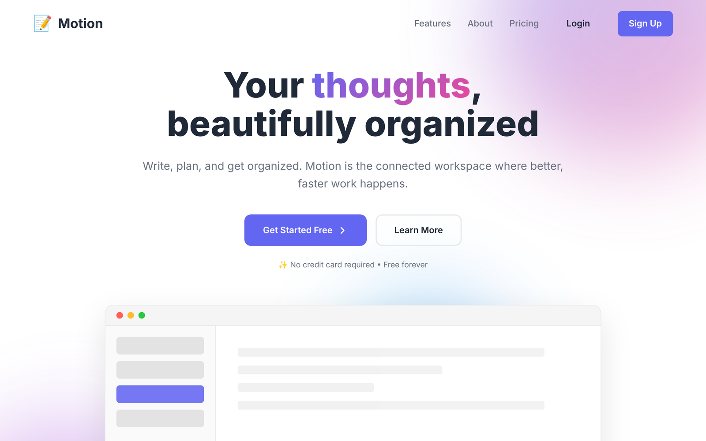
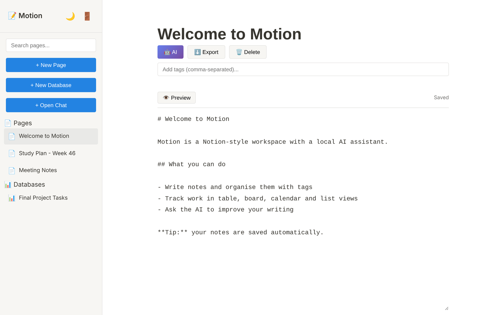
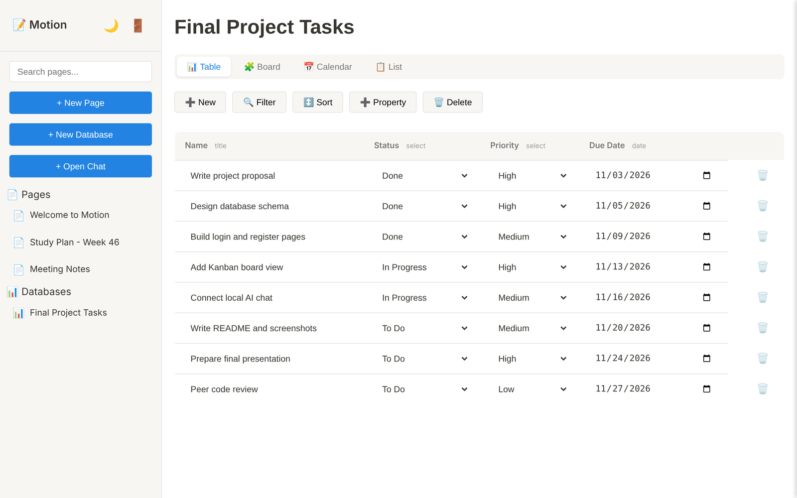
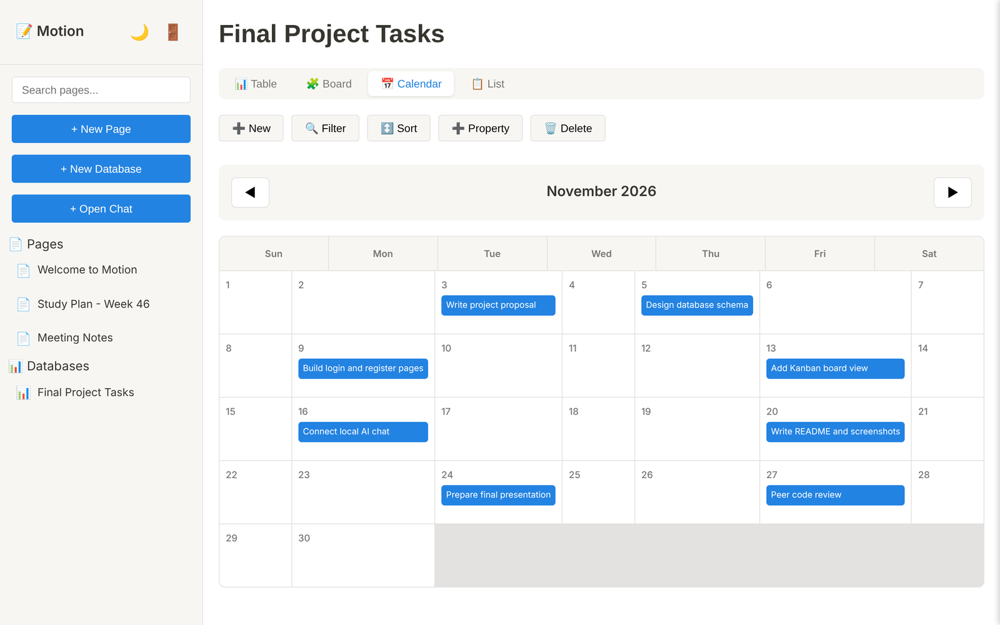
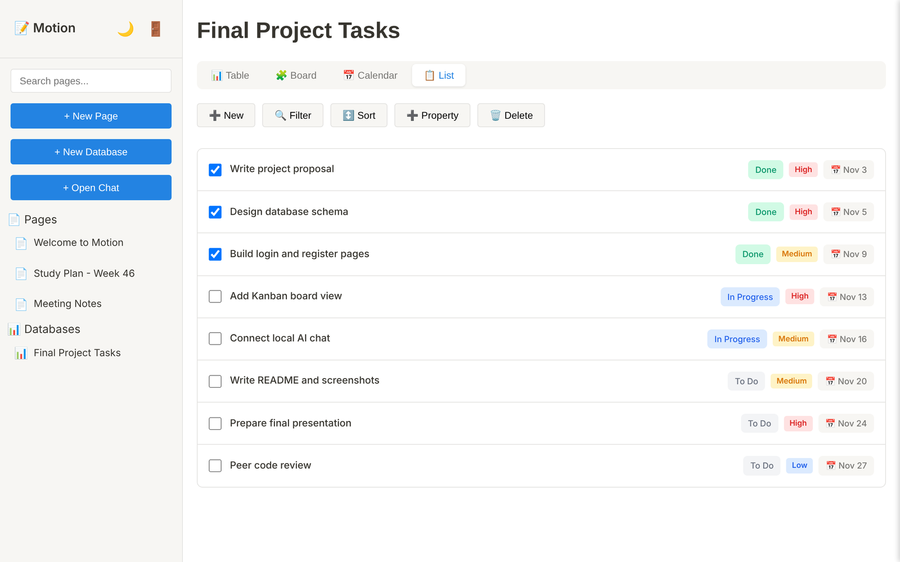

<p align="center">
  
</p>

<h1 align="center">Motion</h1>

<p align="center">
  A Notion-style workspace with pages, databases and a local AI assistant, built with Flask and SQLite.
</p>

---

## Overview

Motion lets you write notes, organise work in databases and chat with an AI model that runs on your own computer. Pages are saved automatically, databases can be viewed as a table, a Kanban board, a calendar or a list, and the AI features use [Ollama](https://ollama.com), so your text never leaves your machine.

<p align="center">
  
</p>

## Features

| Area | What it does |
|---|---|
| **Accounts** | Register and log in. Passwords must have 8+ characters with an uppercase letter, a lowercase letter, a number and a special character. Passwords are stored salted and hashed (PBKDF2-SHA256) |
| **Pages** | Create, edit and delete pages. Markdown-style editor with a Preview toggle, auto-save, tags, search across your pages, and export to a Markdown file |
| **Databases** | Notion-style databases with Name, Status, Priority and Due Date columns by default. Add or delete your own columns, filter and sort items, and switch between four views: **Table**, **Board**, **Calendar** and **List** |
| **AI assistant** | Chat with a local Llama model through Ollama, and use the **AI** button in the page editor to improve the clarity and grammar of your text |
| **Interface** | Landing page, sidebar navigation, light and dark mode |

## Screenshots

<table>
  <tr>
    <td width="50%"><br><sub>Page editor with Preview, AI and Export</sub></td>
    <td width="50%"><br><sub>Database in Table view</sub></td>
  </tr>
  <tr>
    <td width="50%"><br><sub>The same database in Calendar view</sub></td>
    <td width="50%"><br><sub>List view with status and priority tags</sub></td>
  </tr>
</table>

More screens, including the Board view and dark mode, are in the [screenshot gallery](docs/screenshots/README.md). The data in the screenshots is sample data.

## Tech stack

| Layer | Technology |
|---|---|
| Backend | Python 3, Flask 3.0 (Werkzeug 3.0.1) |
| Database | SQLite through the built-in `sqlite3` module |
| Frontend | Jinja2 templates, plain JavaScript, plain CSS (no frameworks) |
| Authentication | Flask sessions, PBKDF2-HMAC-SHA256 password hashing |
| AI | [Ollama](https://ollama.com) running `llama3.1:8b` by default (change it with the `OLLAMA_MODEL` environment variable) |

## Quick start

You need Python 3.10 or newer and Git.

```bash
git clone https://github.com/Garuli/projects.git
cd projects/Motion
python3 -m venv .venv
source .venv/bin/activate          # Windows: .venv\Scripts\activate
pip install -r requirements.txt
python app.py
```

Open **http://127.0.0.1:5001** and create an account.

- The app uses port **5001** because macOS uses port 5000 for AirPlay Receiver. To use another port, run `PORT=8000 python app.py`.
- The database file `motion.db` is created automatically in the folder you run the command from.
- The chat and the AI button need Ollama. Everything else works without it. See [Ollama setup](docs/SETUP.md#set-up-the-ai-ollama).

A full guide for macOS, Windows and Linux, with troubleshooting, is in [docs/SETUP.md](docs/SETUP.md).

## Project structure

```
Motion/
├── README.md              ← this file
├── app.py                 ← Flask app: all routes and the Ollama calls
├── database.py            ← Database class: all SQL
├── requirements.txt       ← Python dependencies
├── templates/             ← HTML pages
├── static/                ← CSS and JavaScript served to the browser
│   ├── css/
│   └── js/
└── docs/                  ← documentation
    ├── screenshots/
    └── images/
```

| Path | What it contains | Details |
|---|---|---|
| `app.py` | Routes for pages, databases, chat, search, export and AI | [API reference](docs/API.md) |
| `database.py` | Table creation and every database query | [Database reference](docs/DATABASE.md) |
| `templates/` | The 8 HTML templates | [templates/README.md](templates/README.md) |
| `static/` | Stylesheets and scripts | [static/README.md](static/README.md) |
| `docs/` | Setup, architecture, API, database, screenshots | [docs/README.md](docs/README.md) |

## Documentation

| Guide | What you will find |
|---|---|
| [Setup](docs/SETUP.md) | Step-by-step install, environment variables, Ollama, troubleshooting |
| [Architecture](docs/ARCHITECTURE.md) | How the pieces fit together, with diagrams |
| [API](docs/API.md) | Every route with its method, purpose and an example |
| [Database](docs/DATABASE.md) | Tables, columns and relationships |
| [Screenshots](docs/screenshots/README.md) | Every screen of the app |

## Notes and limitations

- **Development setup.** The app runs in debug mode and listens on all network interfaces. Do not deploy it as it is.
- **Secret key.** Set your own with the `SECRET_KEY` environment variable. The default value in the code is only for local use.
- **AI features need Ollama.** If Ollama is not running, the chat and the AI button return a clear error instead of a reply.
- **Foreign keys.** The tables declare `ON DELETE CASCADE`, but SQLite does not enforce it unless `PRAGMA foreign_keys` is turned on, which the code does not do yet. See [DATABASE.md](docs/DATABASE.md).
- **No automated tests yet.** The app was tested by hand.

## Credits

Motion started as a team project for a university Software Engineering course (Fall 2025). The logo was generated with ChatGPT. The original team repository, with the full commit history, is at [Garuli/SE-Fall-25-Project](https://github.com/Garuli/SE-Fall-25-Project).
