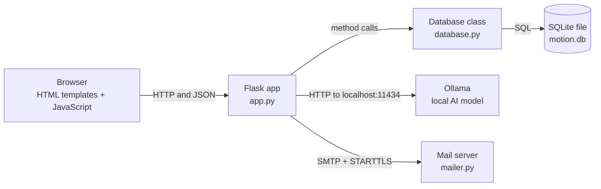
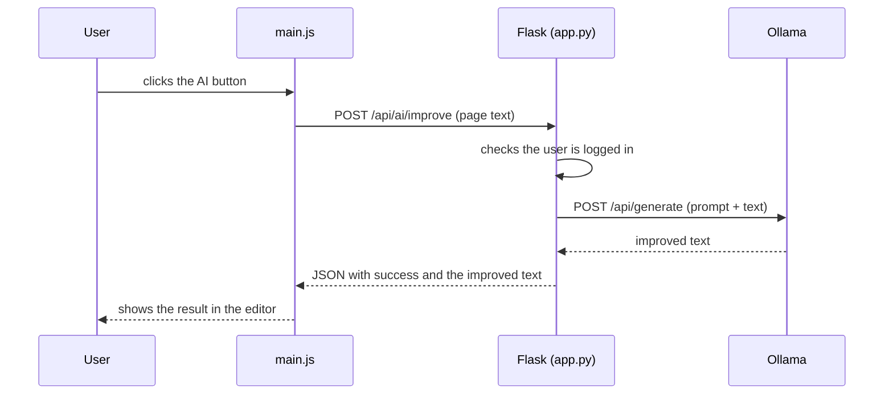
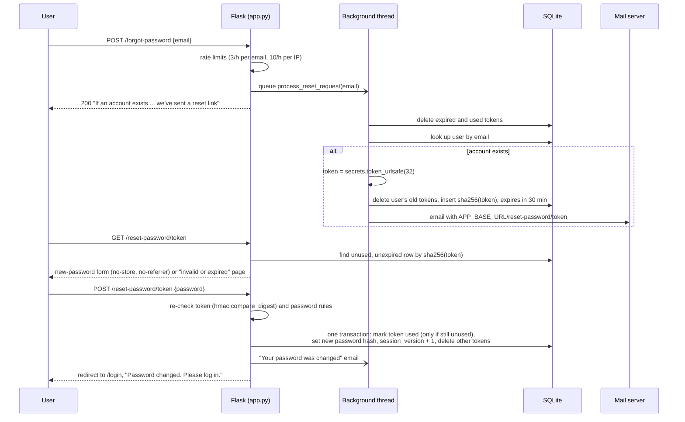

# Architecture

How Motion is built and how a request travels through it.

## Overview

Motion is a classic server-rendered web app with a small JSON API. The browser loads HTML pages from Flask, and JavaScript on those pages calls the API to save and load data.

## Layers

| Layer | File or folder | Responsibility |
|---|---|---|
| Presentation | `templates/`, `static/` | What the user sees and clicks |
| Routes | `app.py` | Receives requests, checks login and ownership, returns HTML or JSON, talks to Ollama |
| Email | `mailer.py` | Sends email over SMTP (stdlib `smtplib`). Used by the password reset flow |
| Data access | `database.py` | Creates the tables and runs every SQL query. One class, `Database` |
| Storage | `motion.db` | A single SQLite file, created automatically |
| AI | Ollama (outside the repo) | Runs the language model on the user's computer |

## Example: improving text with AI

If Ollama is not running, `app.py` catches the connection error and returns a `503` with a message telling the user to start it.

## Example: saving a page

1. You type in the editor. `main.js` waits a moment after the last keystroke (auto-save).
2. It sends `PUT /api/pages/<id>` with the new content.
3. Flask checks the session, loads the page, and confirms the page belongs to the logged-in user.
4. `Database.update_page(...)` runs a parameterised `UPDATE` and the editor shows **Saved**.

## Password reset

Security notes:

- **No account enumeration.** `POST /forgot-password` gives the same body and status for every well-formed email. The database lookup, token creation and SMTP call all run in a background thread, so the response time does not depend on whether the account exists. The per-email rate limit applies to unknown emails too.
- **Only hashes are stored.** The token is 256 random bits from `secrets.token_urlsafe(32)`. The database holds its SHA-256 (a fast hash is enough for a random 256-bit secret, unlike a password). A leaked database cannot be used to reset passwords.
- **Short-lived and single-use.** Tokens expire after 30 minutes. A new request deletes the user's earlier tokens. Using a token is a conditional `UPDATE ... WHERE used_at IS NULL`, so it works exactly once even under concurrent requests. Expired and used rows are deleted whenever any reset is requested.
- **The link can't be pointed elsewhere.** It is built from `APP_BASE_URL`, never from the `Host` or `X-Forwarded-Host` headers, so an attacker can't make Motion email a link to their own server.
- **The token doesn't leak from the page.** The reset page sends `Cache-Control: no-store` and `Referrer-Policy: no-referrer` and loads only first-party files (the CSP blocks anything else). The request log redacts `/reset-password/<token>` paths (`RedactResetTokenFilter` in `app.py`). The raw token is never logged, and is printed only by the opt-in `DEV_MAIL_TO_CONSOLE=1` development fallback.
- **A reset revokes access.** It bumps `session_version`, which logs out every existing session (including an attacker's), sends a "password changed" email, and does not log the user in: they sign in with the new password. Changing the password while logged in does the same, except the current session adopts the new `session_version` and stays logged in.
- **Same rules everywhere.** New passwords go through the same `validate_password()` and the same Werkzeug hash as registration. `POST /reset-password/<token>` is limited to 10 per hour per IP and needs the CSRF token like every other POST.
- **Mail failures don't break the app.** Without `SMTP_HOST` and `MAIL_FROM`, `mailer.py` logs a warning (or prints the email with `DEV_MAIL_TO_CONSOLE=1`). SMTP errors are logged by type, never with the message body.

## Design choices

| Choice | Why |
|---|---|
| Flask | Small, easy to read, and enough for this app |
| SQLite with the standard library | No database server to install. One file holds all the data |
| Plain JavaScript and CSS | No build step. Editing a file and refreshing is enough |
| A local AI model through Ollama | Notes stay private and there is no API key or cost |
| One connection per database method | Simple and safe. Each method opens, uses and closes its own connection |

## Security

| Topic | How it is handled |
|---|---|
| Passwords | Werkzeug `generate_password_hash` (scrypt, salted). Accounts created before this used PBKDF2-SHA256 with 100,000 iterations. Those still work and are re-hashed automatically on the next successful login. Comparisons use `hmac.compare_digest` |
| Password rules | 8 to 128 characters with uppercase, lowercase, a number and a special character. The same rules apply to registration, reset and change |
| Password reset | Emailed single-use link, valid 30 minutes, token stored only as SHA-256. See [Password reset](#password-reset) |
| Login errors | Wrong email and wrong password give the same `Invalid credentials` message. An unknown email is still checked against a dummy hash, so both take about the same time |
| Rate limiting | Flask-Limiter: login 5 per minute and 20 per hour per IP, register 10 per hour per IP, forgot-password 3 per hour per email and 10 per hour per IP, reset-password 10 per hour per IP, change-password 5 per minute and 20 per hour per IP. After 5 failed logins for one email in 15 minutes, that email is locked for 15 minutes (stored in the `login_attempts` table). Returns `429` with a JSON error |
| Secret key | From `SECRET_KEY`, or generated with `secrets.token_hex(32)` and saved to `.secret_key` (mode `600`, ignored by git) |
| Sessions | Flask signed cookies: `HttpOnly`, `SameSite=Lax`, `Secure` when `SESSION_COOKIE_SECURE=1`, 8-hour lifetime counted from login. The session is cleared before login and register (no session fixation). Each user has a `session_version`. It is stored in the session and checked on every request, so bumping it (logout does this) revokes every existing cookie for that user |
| CSRF | A random token per session, put in `<meta name="csrf-token">` on every page. `static/js/csrf.js` adds it as an `X-CSRF-Token` header to every same-origin `fetch` that is not GET. `before_request` checks every POST, PUT and DELETE with `hmac.compare_digest` and returns `403` if it is missing or wrong. Logout is a POST form with the token in a hidden field |
| Security headers | `Content-Security-Policy` (only scripts, styles, images, fonts and connections from the app itself; no inline scripts, inline styles or event handlers; no framing; `object-src 'none'`; `base-uri 'none'`), `X-Content-Type-Options: nosniff`, `X-Frame-Options: DENY`, `Referrer-Policy: no-referrer`, `Permissions-Policy` turning off camera, microphone and geolocation, and `Cache-Control: no-store` on logged-in responses |
| XSS | Jinja2 escapes everything in templates. JavaScript puts user text into the page with `textContent` or `escapeHtml()`. The Markdown preview escapes all HTML first and only creates links for `http`, `https` and `mailto`. Page data reaches the scripts through a `<script type="application/json">` block, not inline JavaScript. Buttons use `data-action` attributes instead of `onclick` |
| Access control | Every route except the landing, login, register, logout, forgot-password and reset-password routes requires login. Routes that touch a page, database, item, column or chat also check that it belongs to the logged-in user, and answer `404` if it does not |
| Input limits | Request bodies are capped at 1 MB (`413`). Bodies must be JSON objects, and fields are checked for type and length: email 254, name 100, title 200, tag 50 (20 tags at most), page content 500,000 characters, chat message 4,000. Bad input gives `400` instead of a crash |
| Database | `PRAGMA foreign_keys = ON` on every connection, so `ON DELETE CASCADE` really removes tags, columns, items and messages with their parent |
| SQL injection | Queries use `?` placeholders instead of building SQL from strings |
| Safe defaults | Listens on `127.0.0.1`, debug mode off. `HOST` and `FLASK_DEBUG=1` change that |
| Dependencies | Flask 3.1.3 and Werkzeug 3.1.9 (no known vulnerabilities according to `pip-audit`). Check again with `pip-audit -r requirements.txt` |
| AI privacy | Text goes only to Ollama on `localhost`. Nothing is sent to an outside service |
| Tests | `tests/test_security.py` covers the items above, `tests/test_password_reset.py` the reset and change-password flow. See [tests/README.md](../tests/README.md) |

## Known gaps

| Gap | Effect | Possible improvement |
|---|---|---|
| Flask development server | `python app.py` is not built for real traffic | Run behind gunicorn (or similar) and a reverse proxy with HTTPS |
| Rate limits stored in memory | They reset on restart and are not shared between processes. Behind a proxy every user has the proxy's IP | Use a shared store such as Redis (`storage_uri`) and werkzeug's `ProxyFix` |
| The email lock can be triggered by anyone | Someone who knows your email can keep your account locked by guessing wrong passwords | Add CAPTCHA or email-based unlock |
| Register says "Email already registered" | Reveals whether an email has an account | Send a confirmation email instead of an on-screen message |
| Logout revokes every session of the user | Logging out on one device logs you out on all of them | Keep a per-session id table if you need per-device logout |
| No email verification | Anyone can register with an email they don't own (they still can't receive its reset links) | Send a confirmation link before activating the account |
| Reset emails run in an in-process thread | An email queued just before the app stops is lost (the user can request another) | Use a task queue for production |
| The per-email reset limit can be used up by anyone | Someone who knows your email can block your resets for an hour | Add CAPTCHA to the forgot-password form |
| Old data written before foreign keys were enforced | Orphan rows from earlier deletes may remain | Run `PRAGMA foreign_key_check` once and delete what it reports |

## Related

- Every route: [API.md](API.md)
- Every table: [DATABASE.md](DATABASE.md)
