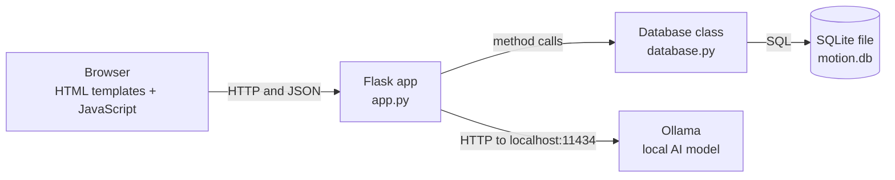
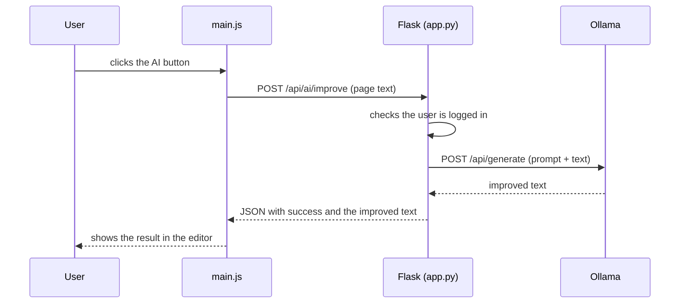

# Architecture

How Motion is built and how a request travels through it.

## Overview

Motion is a classic server-rendered web app with a small JSON API. The browser loads HTML pages from Flask, and JavaScript on those pages calls the API to save and load data.

## Layers

| Layer | File or folder | Responsibility |
|---|---|---|
| Presentation | `templates/`, `static/` | What the user sees and clicks |
| Routes | `app.py` | Receives requests, checks login and ownership, returns HTML or JSON, talks to Ollama |
| Data access | `database.py` | Creates the tables and runs every SQL query. One class, `Database` |
| Storage | `motion.db` | A single SQLite file, created automatically |
| AI | Ollama (outside the repo) | Runs the language model on the user's computer |

## Example: improving text with AI

If Ollama is not running, `app.py` catches the connection error and returns a `503` with a message telling the user to start it.

## Example: saving a page

1. You type in the editor. `main.js` waits a moment after the last keystroke (auto-save).
2. It sends `PUT /api/pages/<id>` with the new content.
3. Flask checks the session, loads the page, and confirms the page belongs to the logged-in user.
4. `Database.update_page(...)` runs a parameterised `UPDATE` and the editor shows **Saved**.

## Design choices

| Choice | Why |
|---|---|
| Flask | Small, easy to read, and enough for this app |
| SQLite with the standard library | No database server to install. One file holds all the data |
| Plain JavaScript and CSS | No build step. Editing a file and refreshing is enough |
| A local AI model through Ollama | Notes stay private and there is no API key or cost |
| One connection per database method | Simple and safe. Each method opens, uses and closes its own connection |

## Security

| Topic | How it is handled |
|---|---|
| Passwords | Salted PBKDF2-HMAC-SHA256 with 100,000 iterations. A random 32-byte salt is stored with each hash. Plain passwords are never stored |
| Password rules | At least 8 characters with uppercase, lowercase, a number and a special character |
| Sessions | Flask signed session cookies. Set `SECRET_KEY` to your own value |
| Access control | Every route except the landing, login and register pages requires login. Routes that touch a page, database, item, column or chat also check that it belongs to the logged-in user |
| SQL injection | Queries use `?` placeholders instead of building SQL from strings |
| AI privacy | Text goes only to Ollama on `localhost`. Nothing is sent to an outside service |

## Known gaps

| Gap | Effect | Possible improvement |
|---|---|---|
| Debug mode on, listening on all interfaces | Fine for local use, unsafe for deployment | Use environment-based settings and a production server such as gunicorn |
| Development default for `SECRET_KEY` | Sessions could be forged if the default is used on a shared machine | Require the variable to be set |
| Foreign keys not enforced | Deleting a parent row may leave child rows behind | Run `PRAGMA foreign_keys = ON` on every connection |
| No automated tests | Changes are only checked by hand | Add `pytest` tests for the API |
| No rate limiting on login | Repeated password guesses are not slowed down | Add rate limiting |

## Related

- Every route: [API.md](API.md)
- Every table: [DATABASE.md](DATABASE.md)
