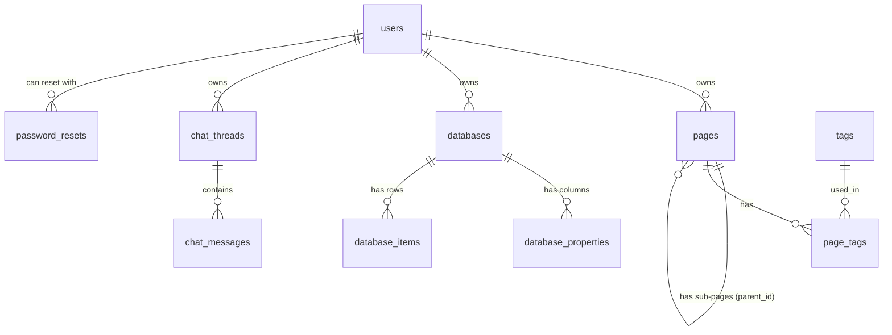

# Database reference

Motion stores everything in one SQLite file, `motion.db`. The tables are created automatically by `database.py` the first time the app starts, so there is nothing to install. Set `MOTION_DB` to use a different file. Small migrations run on start-up too: an older `motion.db` gets the new `session_version` column and the `login_attempts` and `password_resets` tables automatically.

## Relationships

`login_attempts` stands alone. It is keyed by email, not linked to `users`.

## Tables

### `users`

| Column | Type | Notes |
|---|---|---|
| `id` | INTEGER | Primary key |
| `email` | TEXT | Unique, required |
| `password` | BLOB | A Werkzeug hash string such as `scrypt:32768:8:1$salt$hash`. Accounts from before the upgrade may still hold the old format (raw bytes: a 32-byte salt followed by a PBKDF2-SHA256 hash). Those are re-hashed on the next successful login. Never the plain password |
| `name` | TEXT | Required |
| `session_version` | INTEGER | Defaults to `0`. Copied into the session at login and checked on every request. Increasing it (logout does this) revokes all of the user's existing session cookies. Added with `ALTER TABLE` to older databases |
| `created_at` | TIMESTAMP | Defaults to now (UTC) |

### `login_attempts`

Failed logins, used to lock an email after 5 failures in 15 minutes.

| Column | Type | Notes |
|---|---|---|
| `id` | INTEGER | Primary key |
| `email` | TEXT | The email that was tried (also for emails with no account, so the lock does not reveal which accounts exist) |
| `attempted_at` | REAL | Unix time of the attempt. Rows older than 15 minutes are deleted, and a successful login clears that email's rows |

### `password_resets`

Password reset tokens. Only the SHA-256 hash of each token is stored, so a copy of the database cannot be used to reset anyone's password.

| Column | Type | Notes |
|---|---|---|
| `id` | INTEGER | Primary key |
| `user_id` | INTEGER | The account, `ON DELETE CASCADE` |
| `token_hash` | TEXT | Unique. Hex SHA-256 of the token from `secrets.token_urlsafe(32)`. The raw token exists only in the emailed link |
| `created_at` | REAL | Unix time the link was requested |
| `expires_at` | REAL | `created_at` + 30 minutes |
| `used_at` | REAL | Unix time the token was used, `NULL` while unused |

A user has at most one row: a new request deletes the user's older rows first. Every request (for any email) deletes all expired and used rows. A successful reset marks its row used and deletes the user's other rows, and changing the password while logged in deletes them all. Marking a row used is a conditional `UPDATE ... WHERE used_at IS NULL AND expires_at > now`, so two requests with the same link cannot both succeed.

### `pages`

| Column | Type | Notes |
|---|---|---|
| `id` | INTEGER | Primary key |
| `title` | TEXT | Required |
| `content` | TEXT | Markdown-style text. Defaults to empty |
| `user_id` | INTEGER | Owner, references `users(id)` |
| `parent_id` | INTEGER | Optional parent page, references `pages(id)` |
| `icon` | TEXT | Defaults to 📄 |
| `created_at`, `updated_at` | TIMESTAMP | Default to now (UTC) |

### `tags` and `page_tags`

| Table | Columns | Notes |
|---|---|---|
| `tags` | `id`, `name` | Tag names are unique |
| `page_tags` | `page_id`, `tag_id` | Links pages and tags (many-to-many) |

### `databases`

| Column | Type | Notes |
|---|---|---|
| `id` | INTEGER | Primary key |
| `title` | TEXT | Required |
| `user_id` | INTEGER | Owner, references `users(id)` |
| `view_type` | TEXT | Current view. Defaults to `table` (the others are `board`, `calendar` and `list`) |
| `icon` | TEXT | Defaults to 📊 |
| `created_at`, `updated_at` | TIMESTAMP | Default to now (UTC) |

### `database_properties` (the columns of a database)

| Column | Type | Notes |
|---|---|---|
| `id` | INTEGER | Primary key |
| `database_id` | INTEGER | References `databases(id)` |
| `name` | TEXT | For example `Status` |
| `type` | TEXT | For example `title`, `select`, `date` or `text` |
| `order_index` | INTEGER | Position of the column |
| `options` | TEXT | JSON list of choices for `select` columns, for example `["To Do", "In Progress", "Done"]` |

### `database_items` (the rows of a database)

| Column | Type | Notes |
|---|---|---|
| `id` | INTEGER | Primary key |
| `database_id` | INTEGER | References `databases(id)` |
| `properties` | TEXT | JSON object whose keys are column names, for example `{"Name": "Write README", "Status": "To Do"}` |
| `order_index` | INTEGER | Position of the row |
| `created_at`, `updated_at` | TIMESTAMP | Default to now (UTC) |

### `chat_threads` and `chat_messages`

| Table | Columns | Notes |
|---|---|---|
| `chat_threads` | `id`, `user_id`, `title`, `created_at`, `updated_at` | One row per conversation |
| `chat_messages` | `id`, `chat_id`, `role`, `content`, `created_at` | `role` is who wrote the message (the user or the assistant) |

## Notes

- **Item values are stored as JSON, keyed by column name.** This keeps the schema simple, but it means renaming a column does not rename the keys inside existing items.
- **Foreign keys are enforced.** `get_connection()` runs `PRAGMA foreign_keys = ON` on every connection, so `ON DELETE CASCADE` works: deleting a page removes its tags links and sub-pages, deleting a database removes its columns and items, and deleting a chat removes its messages. Rows orphaned before this change are not cleaned up automatically. `PRAGMA foreign_key_check` lists them.
- **Timestamps are UTC.** They use SQLite's `CURRENT_TIMESTAMP`, except `login_attempts` and `password_resets`, which store Unix time as `REAL`.
- **Queries use `?` placeholders**, never string formatting, to prevent SQL injection.
- **`motion.db` is not stored in git.** It holds user accounts, so it is listed in `.gitignore`. Delete the file to reset the app.

## Related

- Routes that read and write these tables: [API.md](API.md)
- How the layers connect: [ARCHITECTURE.md](ARCHITECTURE.md)
