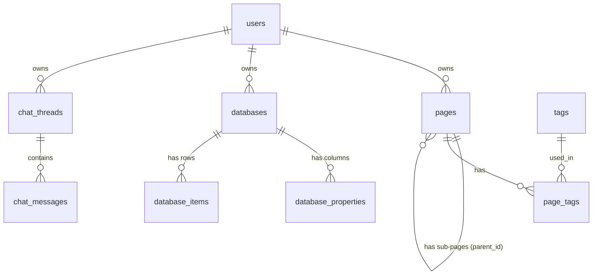

# Database reference

Motion stores everything in one SQLite file, `motion.db`. The tables are created automatically by `database.py` the first time the app starts, so there is nothing to install or migrate.

## Relationships

## Tables

### `users`

| Column | Type | Notes |
|---|---|---|
| `id` | INTEGER | Primary key |
| `email` | TEXT | Unique, required |
| `password` | BLOB | The 32-byte salt followed by the PBKDF2-SHA256 hash. Never the plain password |
| `name` | TEXT | Required |
| `created_at` | TIMESTAMP | Defaults to now (UTC) |

### `pages`

| Column | Type | Notes |
|---|---|---|
| `id` | INTEGER | Primary key |
| `title` | TEXT | Required |
| `content` | TEXT | Markdown-style text. Defaults to empty |
| `user_id` | INTEGER | Owner, references `users(id)` |
| `parent_id` | INTEGER | Optional parent page, references `pages(id)` |
| `icon` | TEXT | Defaults to 📄 |
| `created_at`, `updated_at` | TIMESTAMP | Default to now (UTC) |

### `tags` and `page_tags`

| Table | Columns | Notes |
|---|---|---|
| `tags` | `id`, `name` | Tag names are unique |
| `page_tags` | `page_id`, `tag_id` | Links pages and tags (many-to-many) |

### `databases`

| Column | Type | Notes |
|---|---|---|
| `id` | INTEGER | Primary key |
| `title` | TEXT | Required |
| `user_id` | INTEGER | Owner, references `users(id)` |
| `view_type` | TEXT | Current view. Defaults to `table` (the others are `board`, `calendar` and `list`) |
| `icon` | TEXT | Defaults to 📊 |
| `created_at`, `updated_at` | TIMESTAMP | Default to now (UTC) |

### `database_properties` (the columns of a database)

| Column | Type | Notes |
|---|---|---|
| `id` | INTEGER | Primary key |
| `database_id` | INTEGER | References `databases(id)` |
| `name` | TEXT | For example `Status` |
| `type` | TEXT | For example `title`, `select`, `date` or `text` |
| `order_index` | INTEGER | Position of the column |
| `options` | TEXT | JSON list of choices for `select` columns, for example `["To Do", "In Progress", "Done"]` |

### `database_items` (the rows of a database)

| Column | Type | Notes |
|---|---|---|
| `id` | INTEGER | Primary key |
| `database_id` | INTEGER | References `databases(id)` |
| `properties` | TEXT | JSON object whose keys are column names, for example `{"Name": "Write README", "Status": "To Do"}` |
| `order_index` | INTEGER | Position of the row |
| `created_at`, `updated_at` | TIMESTAMP | Default to now (UTC) |

### `chat_threads` and `chat_messages`

| Table | Columns | Notes |
|---|---|---|
| `chat_threads` | `id`, `user_id`, `title`, `created_at`, `updated_at` | One row per conversation |
| `chat_messages` | `id`, `chat_id`, `role`, `content`, `created_at` | `role` is who wrote the message (the user or the assistant) |

## Notes

- **Item values are stored as JSON, keyed by column name.** This keeps the schema simple, but it means renaming a column does not rename the keys inside existing items.
- **Cascading deletes are declared but not enforced.** The tables use `ON DELETE CASCADE`, but SQLite only enforces foreign keys when `PRAGMA foreign_keys = ON` is run on each connection, and the code does not do that yet. Deleting a parent row can leave child rows behind.
- **Timestamps are UTC.** They use SQLite's `CURRENT_TIMESTAMP`.
- **Queries use `?` placeholders**, never string formatting, to prevent SQL injection.
- **`motion.db` is not stored in git.** It holds user accounts, so it is listed in `.gitignore`. Delete the file to reset the app.

## Related

- Routes that read and write these tables: [API.md](API.md)
- How the layers connect: [ARCHITECTURE.md](ARCHITECTURE.md)
