# Screenshots

Every screen of Motion. All screenshots were taken from a clean copy of the app running locally, and everything in them (the user, the pages, the tasks) is **sample data**.

| File | Screen |
|---|---|
| `landing.png` | Landing page |
| `login.png` | Login |
| `register.png` | Sign-up with the password checklist |
| `dashboard.png` | Dashboard after login |
| `page-editor.png` | Page editor |
| `database-table.png` | Database, Table view |
| `database-board.png` | Database, Board (Kanban) view |
| `database-calendar.png` | Database, Calendar view |
| `database-list.png` | Database, List view |
| `dark-mode-board.png` | Board view in dark mode |
| `chat.png` | AI chat (empty) |

## Public pages

### Landing page
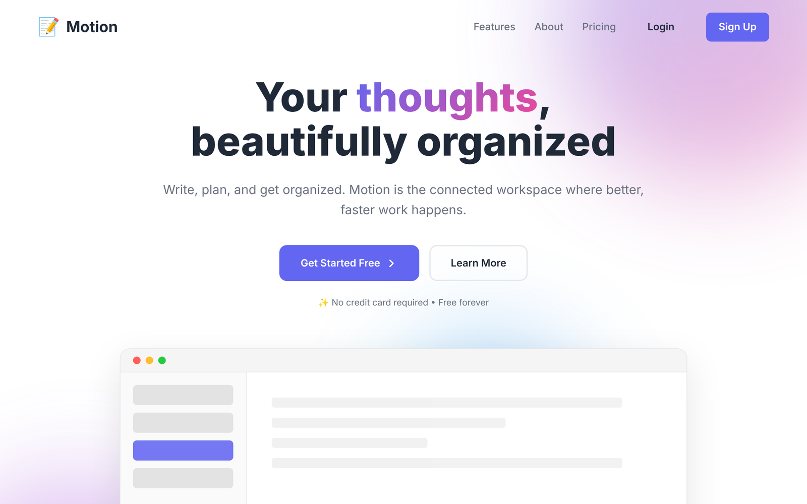

### Login
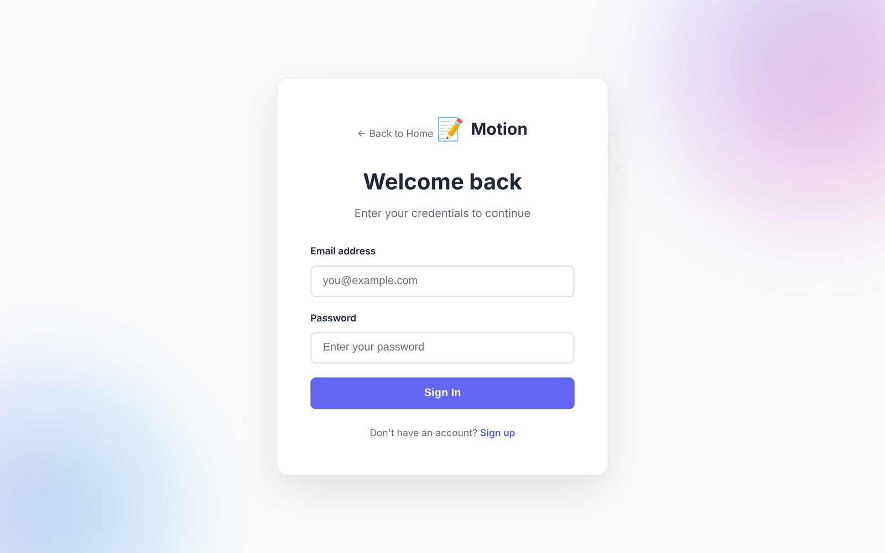

### Sign up
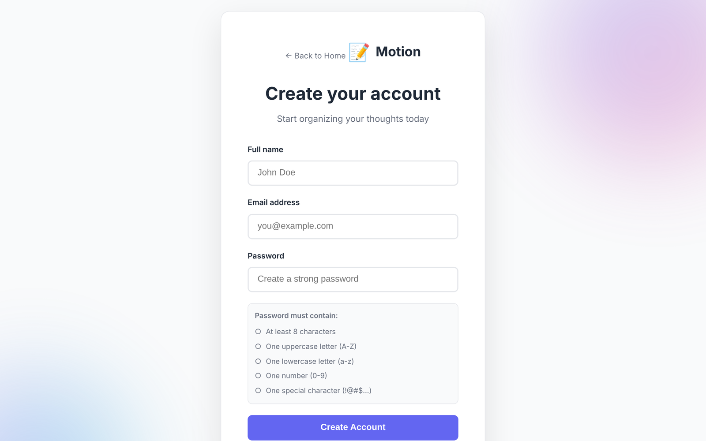

## Inside the app

### Dashboard
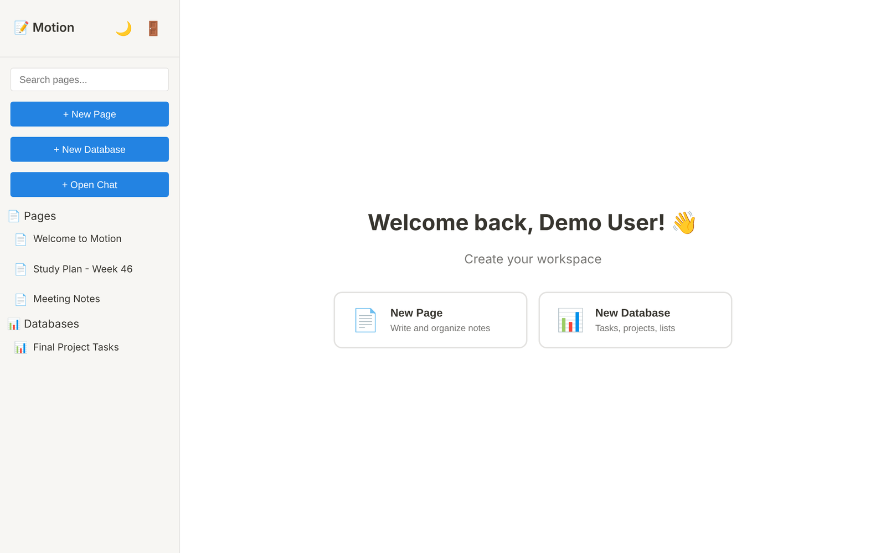

### Page editor
The editor has a **Preview** toggle, an **AI** button that improves the text, an **Export** button that downloads Markdown, and a tag field. The **Saved** label confirms auto-save.

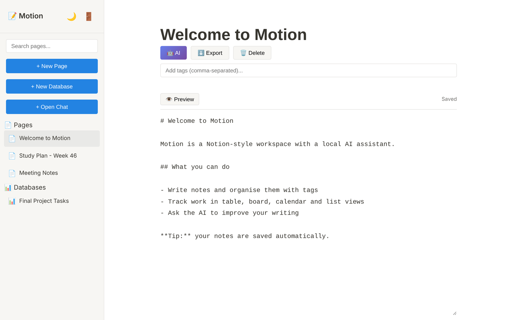

## Databases

The same database shown in the four views. Use the buttons above the data to switch.

### Table
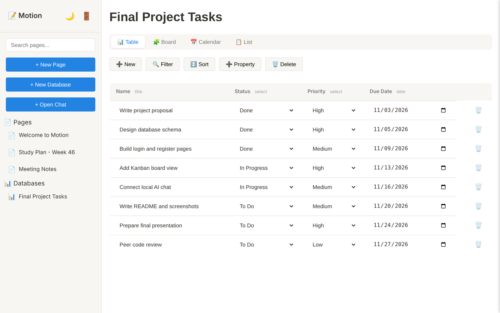

### Board
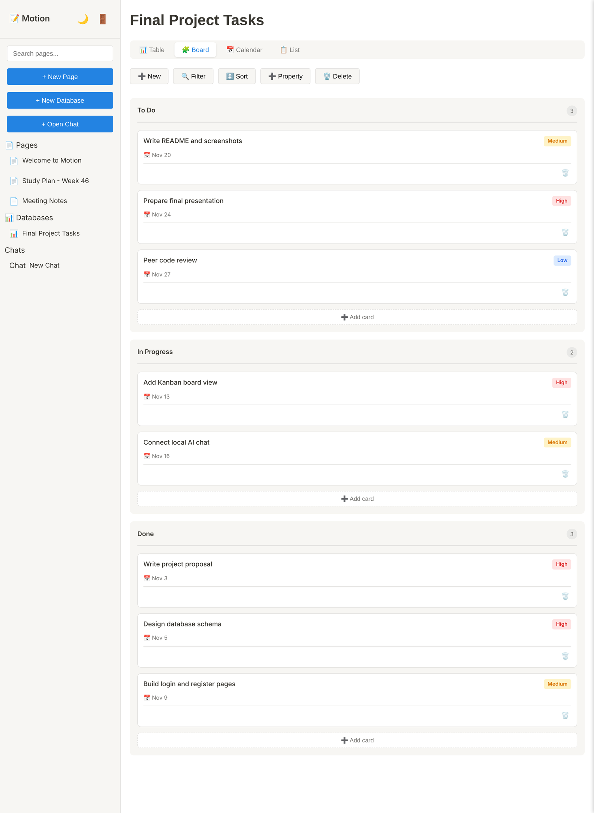

### Calendar
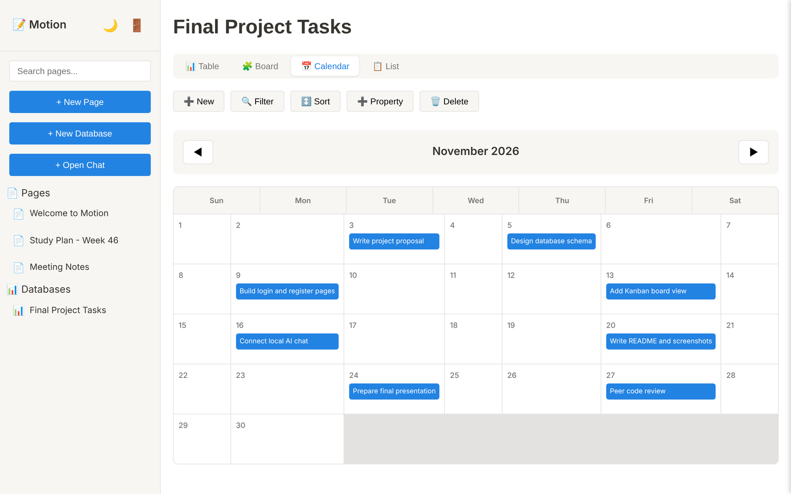

### List
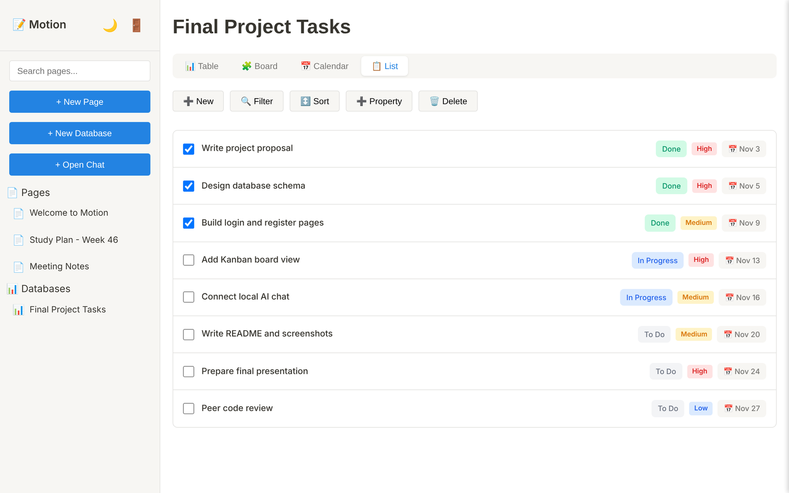

## Dark mode

The moon button in the sidebar switches the theme, and the choice is remembered.

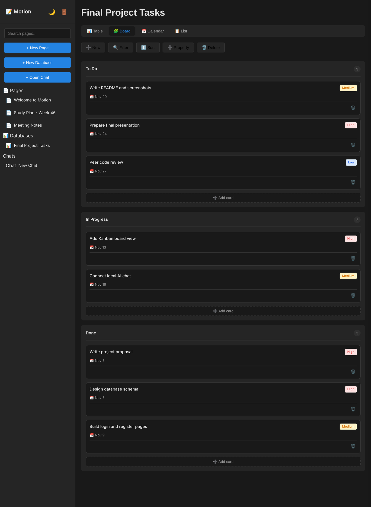

## AI chat

The chat screen is shown empty. Ollama was not running when these screenshots were taken, so there are no AI replies here. To see them, follow the [Ollama setup](../SETUP.md#set-up-the-ai-ollama).

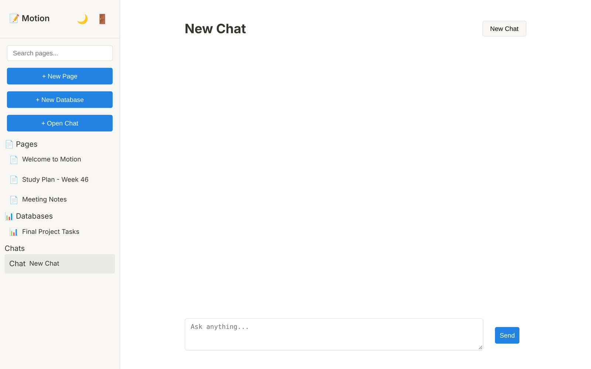

## Adding more screenshots

1. Run the app and take the screenshot, ideally with a window about 1280 px wide.
2. Save it here as a PNG with a short lowercase name, such as `chat-reply.png`.
3. Add a row to the table above and an image below, like ``.
