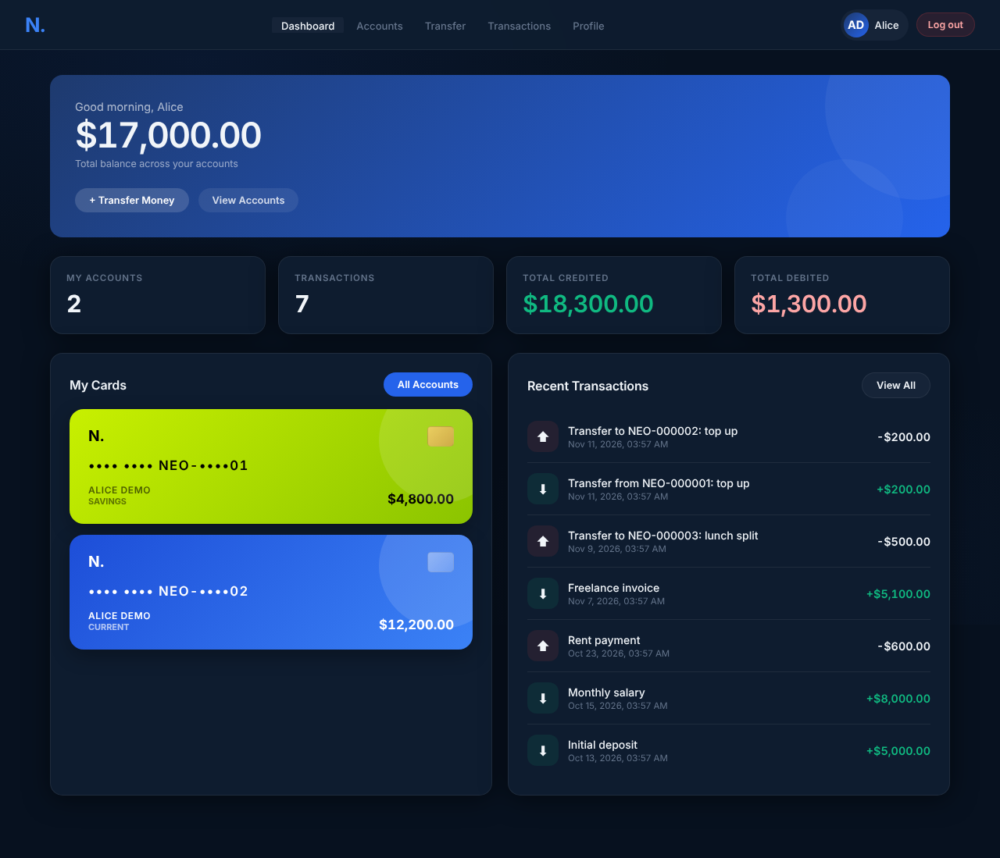
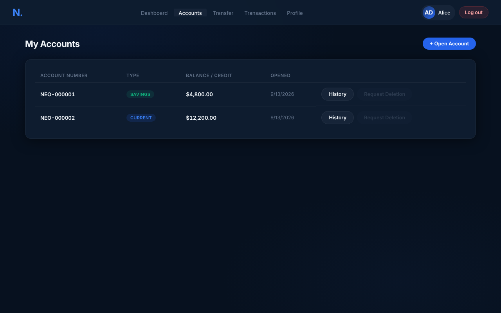
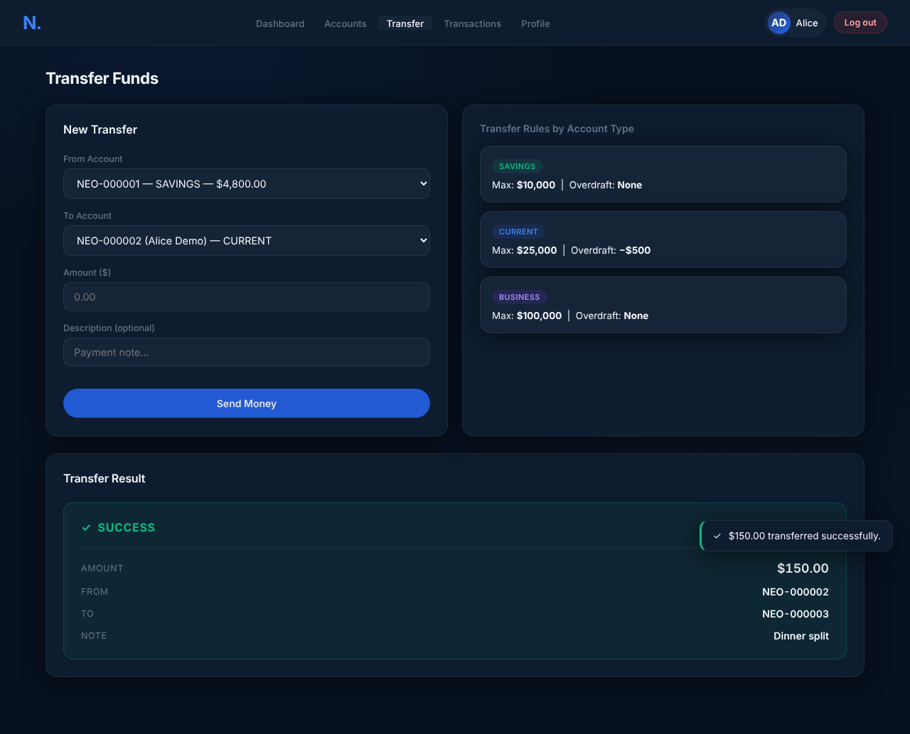
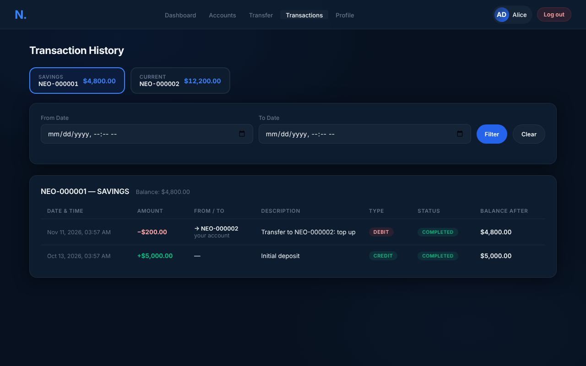
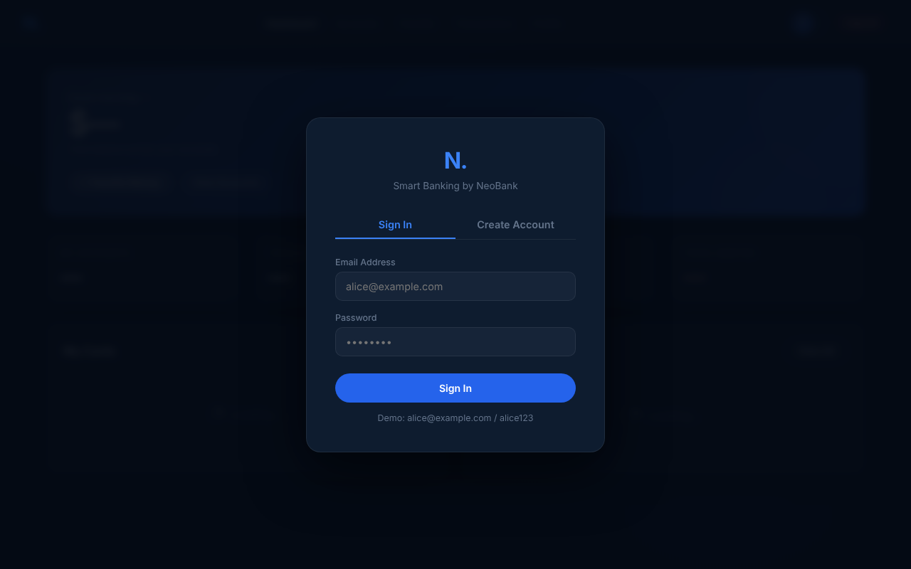

<h1 align="center">NeoBank</h1>

<p align="center">
  A small banking system with a web dashboard and a REST API, built with Java 21, Spring Boot and JWT login.
</p>

---

## Overview

NeoBank lets customers log in, see their accounts, transfer money, read their transaction history and view a summary of their finances. Everything is served by one Spring Boot application: a JSON API under `/api` and a single-page dashboard at `http://localhost:8080`. A database is created and filled with demo data the first time it starts, so there is nothing to install besides Java and Maven.

It was built as a CS 305 capstone (Advanced Java) and is also used as a Software Engineering course project at UNYT. I built it on my own.

> **A demo.** NeoBank is a learning project. The money, customers and accounts are made up, and it is not meant to run a real bank.

<p align="center">
  
</p>

## Features

| Area | What it does |
|---|---|
| **Accounts and login** | Register or log in with email and password. Passwords are hashed with BCrypt and a JWT token proves who you are on every request |
| **Account types** | Savings, Current, Business, Student, Checking and Premium accounts, each with its own interest rate, overdraft floor and transfer limit. Credit accounts track an available credit line |
| **Transfers** | Move money between accounts in one database transaction. Each transfer creates a matching debit and credit, and is refused for insufficient funds, amounts over the limit, zero or negative amounts, or the same account on both sides |
| **Transaction history** | Newest first, per account or for all your accounts, with a date filter |
| **Reports** | Totals, averages, credited and debited amounts and the five largest transactions |
| **Account deletion** | Request deletion of an account with a zero balance. A scheduled job processes requests every minute |
| **API docs** | Swagger UI to read and try every endpoint |

## Screenshots

<table>
  <tr>
    <td width="50%"><br><sub>Accounts</sub></td>
    <td width="50%"><br><sub>A completed transfer</sub></td>
  </tr>
  <tr>
    <td width="50%"><br><sub>Transaction history</sub></td>
    <td width="50%"><br><sub>Login</sub></td>
  </tr>
</table>

More are in the [screenshot gallery](docs/screenshots/README.md).

## Tech stack

| Layer | Technology |
|---|---|
| Language | Java 21 |
| Framework | Spring Boot 3.2 (Web, Data JPA, Validation, Security) |
| Database | H2, stored in a local file (`./data`), accessed with JPA and one raw JDBC repository |
| Authentication | Spring Security, JWT (jjwt), BCrypt |
| API docs | springdoc OpenAPI (Swagger UI) |
| Frontend | One HTML file with plain JavaScript and CSS, served by Spring |
| Tests | JUnit 5, Spring Boot Test, MockMvc |
| Build | Maven |

## Quick start

You need **Java 21+** and **Maven 3.8+**.

```bash
git clone https://github.com/Garuli/projects.git
cd projects/NeoBank
mvn spring-boot:run
```

Open http://localhost:8080 and log in with a demo user:

| Name | Email | Password |
|---|---|---|
| Alice Demo | `alice@example.com` | `alice123` |
| Bob Demo | `bob@example.com` | `bob123` |
| Carol Demo | `carol@example.com` | `carol123` |

Swagger UI: http://localhost:8080/swagger-ui.html. To reset the demo data, stop the app and delete the `data/` folder.

### Run the tests

```bash
mvn test
```

The tests start the app with an in-memory database and check logins, ownership rules and transfer rules through the real API.

### Settings (environment variables)

| Variable | Default | Purpose |
|---|---|---|
| `NEOBANK_JWT_SECRET` | random each run | Key that signs login tokens, 32+ characters. Set it if you want logins to survive a restart |
| `NEOBANK_JWT_EXPIRATION_MS` | `86400000` (24 h) | How long a login lasts |
| `H2_CONSOLE_ENABLED` | `false` | Set to `true` to open the database console at `/h2-console` (JDBC URL `jdbc:h2:file:./data/neobankdb`, user `sa`, empty password) |

Example: `NEOBANK_JWT_SECRET="$(openssl rand -base64 48)" mvn spring-boot:run`

## Project layout

```
NeoBank/
├── README.md
├── pom.xml
├── .gitignore
├── src/
│   ├── main/
│   │   ├── java/com/neobank/   ← controllers, services, repositories, security, patterns
│   │   └── resources/          ← settings and the dashboard (static/index.html)
│   └── test/                   ← automated tests
└── docs/                       ← architecture, API, database, screenshots
```

Each folder has its own README. Start with [docs/ARCHITECTURE.md](docs/ARCHITECTURE.md).

## What I practised

| Topic | Where |
|---|---|
| Layered architecture (controller, service, repository) | `controller/`, `service/`, `repository/` |
| Design patterns: Factory and Strategy | `pattern/` |
| Collections, generics, lambdas and streams | `service/`, `util/` |
| Concurrency: `CompletableFuture`, executors, atomic counters | `TransactionService`, `util/TransactionIdGenerator` |
| JPA and raw JDBC | `repository/` |
| REST design, validation and one error format | `controller/`, `exception/` |
| JWT authentication and per-user access control | `security/` |

## Security notes

| Topic | How it is handled |
|---|---|
| Passwords | BCrypt hashes, never stored in plain text |
| Login tokens | Signed JWT. The signing key comes from `NEOBANK_JWT_SECRET`, not from the source code |
| Access control | A logged-in user can only read their own accounts, transactions, report and profile, and can only transfer out of their own accounts. Other people's data returns `403` |
| Database console | Off unless you turn it on |
| Known limits | See [Known limits](docs/ARCHITECTURE.md#known-limits) |
