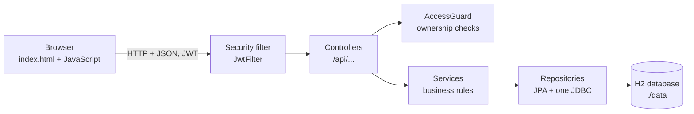
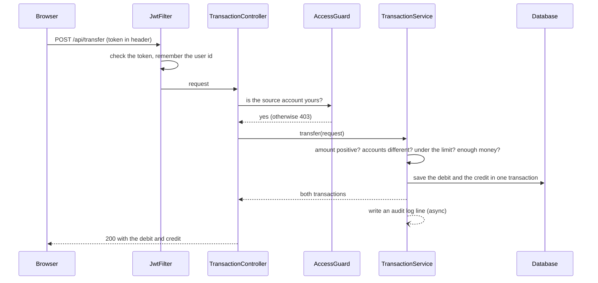

# Architecture

NeoBank is one Spring Boot application. The browser loads a single HTML page from it, and JavaScript on that page calls the JSON API.

## Layers

| Layer | Package | Responsibility |
|---|---|---|
| Presentation | `resources/static/index.html` | The dashboard: login, accounts, transfer, transactions, profile |
| Security | `security/`, `config/SecurityConfig` | Reads the JWT, signs in the user for the request, checks who owns what |
| Controllers | `controller/` | Receive requests, check access, return the same JSON envelope every time |
| Services | `service/` | Business rules: transfers, limits, reports, deletion requests |
| Patterns | `pattern/` | Factory for creating accounts, Strategy for rates and limits per account type |
| Repositories | `repository/` | Database access with Spring Data JPA, plus one raw JDBC repository |
| Errors | `exception/` | One handler turns exceptions into clean HTTP responses |

## A transfer, step by step

The rules that can refuse a transfer:

| Rule | Result |
|---|---|
| Amount is zero or negative | `400` |
| Source and destination are the same account | `400` |
| Amount is over the transfer limit of the source account type | `422` |
| Not enough money (the overdraft floor depends on the account type) | `422` |
| The source account belongs to someone else | `403` |

## Design patterns

| Pattern | Where | What it does |
|---|---|---|
| **Factory** | `pattern/factory/AccountFactory` | Creates an account of the requested type, with the right setup, in one place |
| **Strategy** | `pattern/strategy/*InterestStrategy` | Each account type decides its own interest, overdraft floor and transfer limit. The transfer code asks the strategy instead of using `if` chains |

## Security

| Topic | How it is handled |
|---|---|
| Passwords | BCrypt hashes |
| Login | `POST /api/auth/login` returns a signed JWT that the browser sends in the `Authorization: Bearer` header |
| Signing key | From `NEOBANK_JWT_SECRET` (32+ characters). If it is missing, a random key is created for that run |
| Ownership | `AccessGuard` compares the logged-in user with the owner of the account or the user id in the request. Other people's data returns `403`, and an unknown id looks the same as someone else's |
| SQL injection | JPA queries and prepared statements, no string-built SQL |
| CSRF | Disabled on purpose. The API uses a token header instead of cookies, so there is nothing for a forged form to ride on |
| Database console | Off unless `H2_CONSOLE_ENABLED=true` |

## Known limits

This is a demo, so some things are left simple on purpose.

| Limit | Effect | Possible improvement |
|---|---|---|
| `GET /api/accounts` lists every customer's accounts | The transfer screen needs it to pick a destination, but it shows other customers' names and balances | Return only a name and account number, or look the destination up by account number |
| `GET /api/reports/summary` is bank-wide | Any logged-in user can see bank totals | Restrict it to an admin role |
| No limit on login attempts | Passwords could be guessed slowly | Add rate limiting or a lockout |
| No locking for simultaneous transfers | Two transfers from the same account at the same moment could both pass the balance check | Add optimistic or pessimistic locking |
| The token is stored in the browser's `localStorage` | A script injected into the page could read it | Use a short-lived token in an `HttpOnly` cookie |
| No "forgot password" | A forgotten password cannot be recovered | Add an emailed reset link, as in my [Motion](../../Motion/README.md) project |
| Demo users have simple passwords | Fine for a demo, never for real use | Remove the seed data in production |
