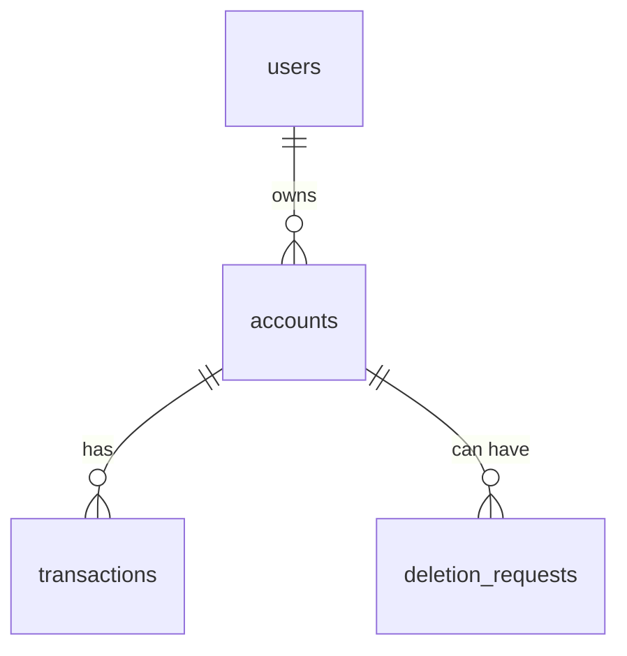

# Database

NeoBank uses H2, a small database that lives in a file (`./data/neobankdb`). Hibernate creates the tables when the app starts (`ddl-auto=update`), and `DataInitializer` adds three demo users, five accounts and 15 transactions if the database is empty. Delete the `data/` folder to start fresh.

## Tables

### `users`

| Column | Notes |
|---|---|
| `id` | Primary key |
| `name`, `email`, `phone`, `address` | Customer details. `email` is unique |
| `password` | BCrypt hash |
| `profile_picture` | Optional image data |
| `created_at` | When the user was created |

### `accounts`

| Column | Notes |
|---|---|
| `id` | Primary key |
| `account_number` | Public number such as `NEO-000001`. Unique |
| `type` | `SAVINGS`, `CURRENT`, `BUSINESS`, `STUDENT`, `CHECKING` or `PREMIUM` |
| `category` | `DEBIT` or `CREDIT` |
| `balance` | Money in the account (for credit accounts, the amount owed) |
| `credit_limit`, `available_credit` | Only for credit accounts |
| `user_id` | The owner |
| `created_at` | When it was opened |

### `transactions`

| Column | Notes |
|---|---|
| `id` | Primary key |
| `account_id` | The account this line belongs to |
| `type` | `CREDIT` (money in) or `DEBIT` (money out) |
| `amount`, `balance_after` | The amount and the balance right after it |
| `description`, `status`, `timestamp` | Text, `COMPLETED`, and when it happened |
| `transfer_ref` | Shared by the debit and credit lines of one transfer |
| `counterpart_account_number`, `counterpart_email` | The other side of a transfer |

### `deletion_requests`

| Column | Notes |
|---|---|
| `id`, `account_id` | Primary key and the account |
| `status` | Where the request is (pending, then processed) |
| `requested_at`, `processed_at` | Timestamps. A scheduled job handles pending requests every minute |

## Notes

- A transfer writes two rows in `transactions` (a debit and a credit) that share a `transfer_ref`.
- Money is stored as `BigDecimal` (exact decimals), never `double`.
- The `data/` folder is listed in `.gitignore`, so the database is never committed.
