# Screenshots

Desktop (1440 px wide) and phone (390 px wide, app-style bottom tab bar) views with the demo data, user **Alice Demo**. In the Cards and later desktop shots the Current account is frozen, to show that state.

> These were captured from the real front end (`index.html`, `app.css`, `app.js`) with a stand-in API that returns the same demo data as a fresh install, because the Spring Boot server could not be started where the shots were taken. To replace them with captures of the running app, follow the steps at the end.

| Screen | Desktop | Phone |
|---|---|---|
| Login and sign up | `login.png` | `login-phone.png` |
| Dashboard: balance, last 7 days, cards, quick send, recent activity | `dashboard.png` | `dashboard-phone.png` |
| Cards: one per account, freeze, show number, history, close | `cards.png` | `cards-phone.png` |
| Send money to a contact, an account number or your own account | `send.png` | `send-phone.png` |
| Activity: filters, account picker and search | `activity.png` | `activity-phone.png` |
| Analytics: money in and out, balance curve, where it went | `analytics.png` | `analytics-phone.png` |
| Saved contacts | `contacts.png` | `contacts-phone.png` |
| Profile, photo and change password | `profile.png` | `profile-phone.png` |

## Desktop

### Login and sign up
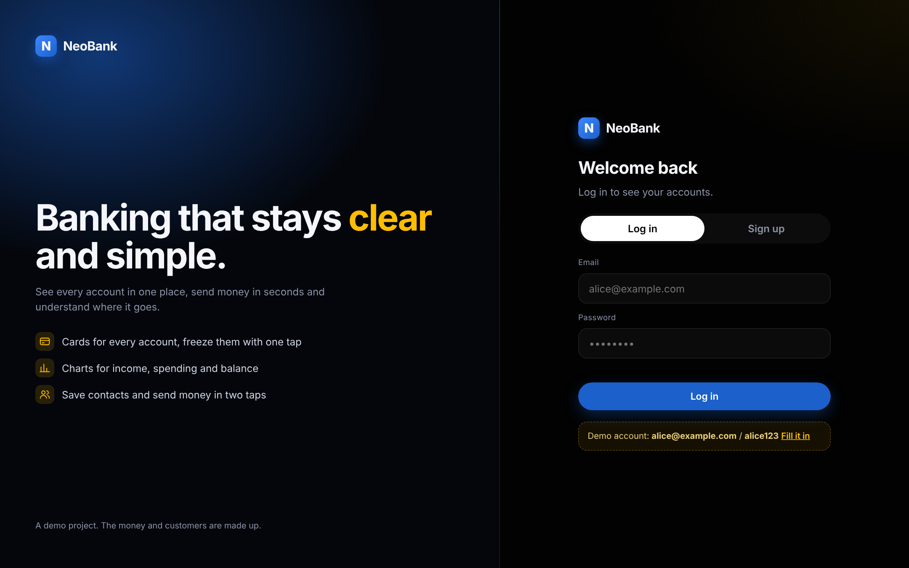

### Dashboard: balance, last 7 days, cards, quick send, recent activity
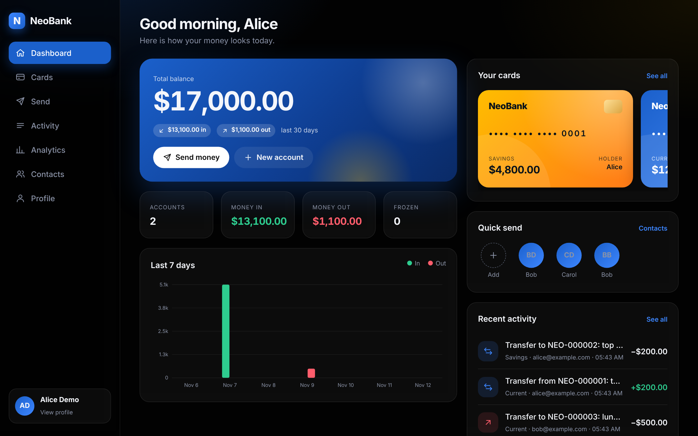

### Cards: one per account, freeze, show number, history, close
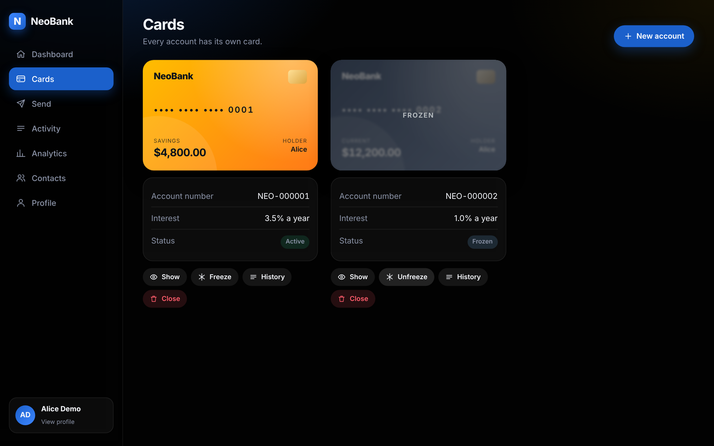

### Send money to a contact, an account number or your own account
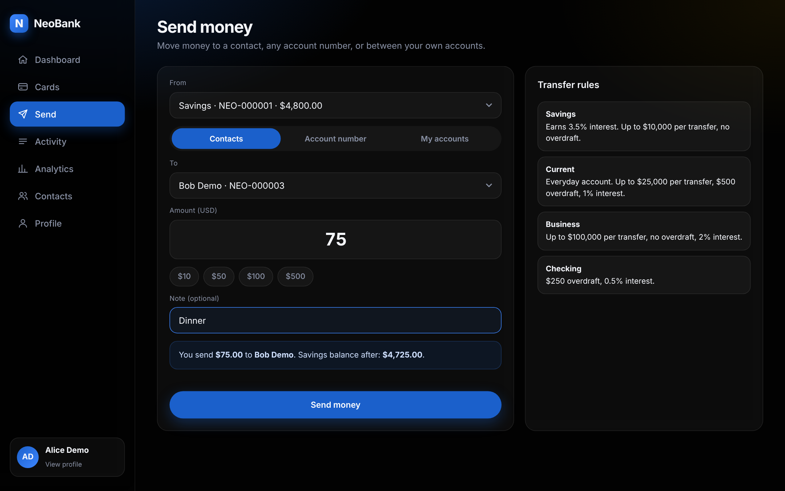

### Activity: filters, account picker and search
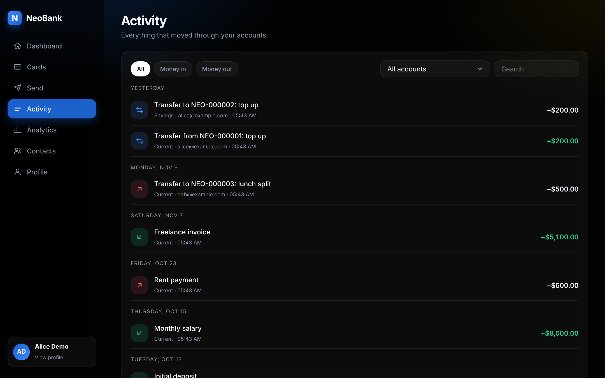

### Analytics: money in and out, balance curve, where it went
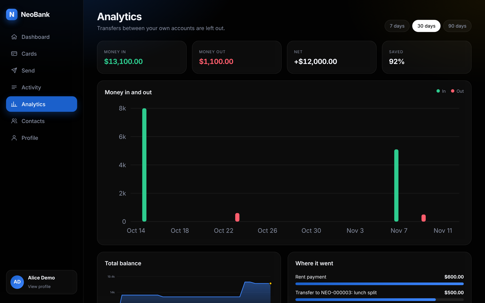

### Saved contacts
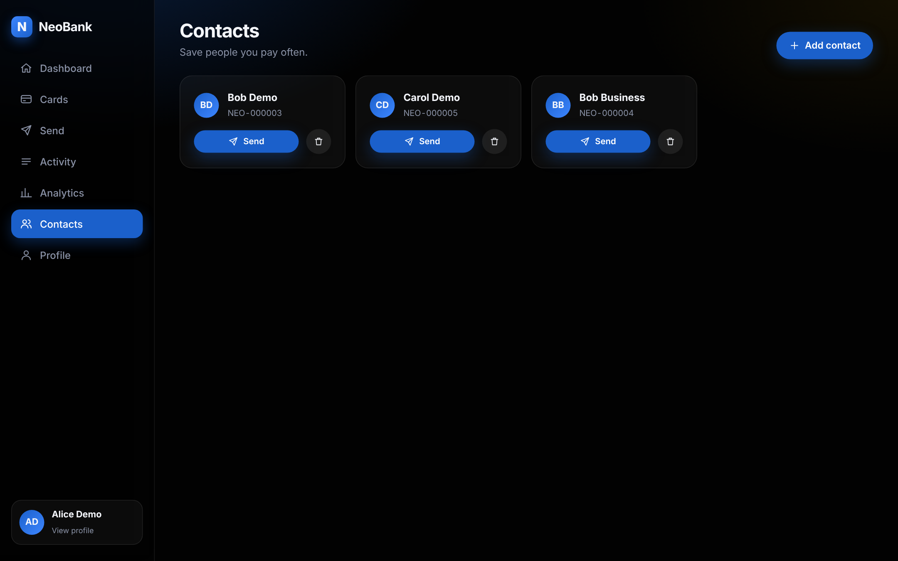

### Profile, photo and change password

## Phone

  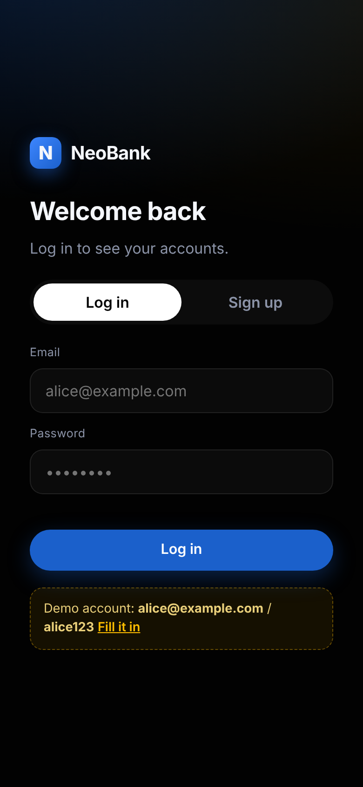
  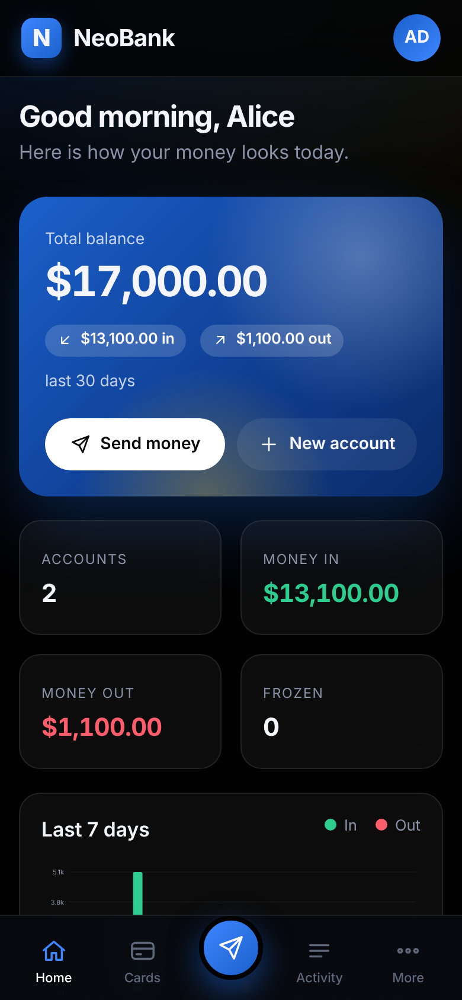
  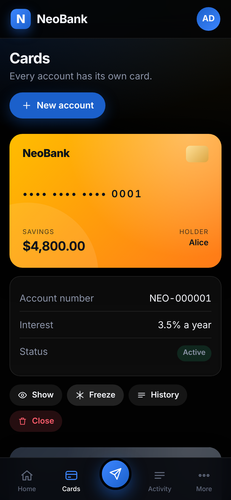
  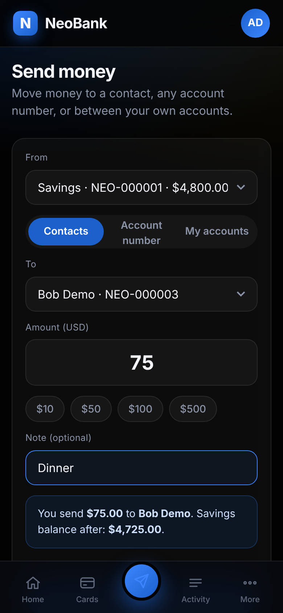
  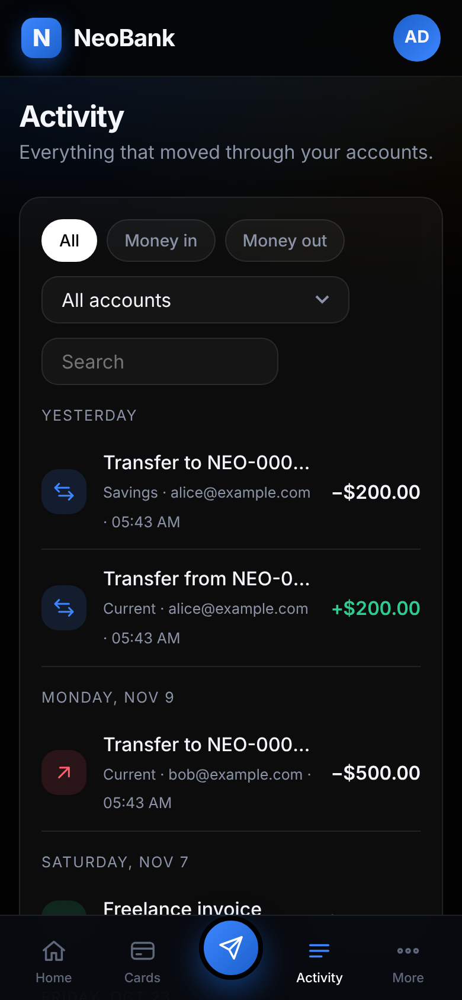
  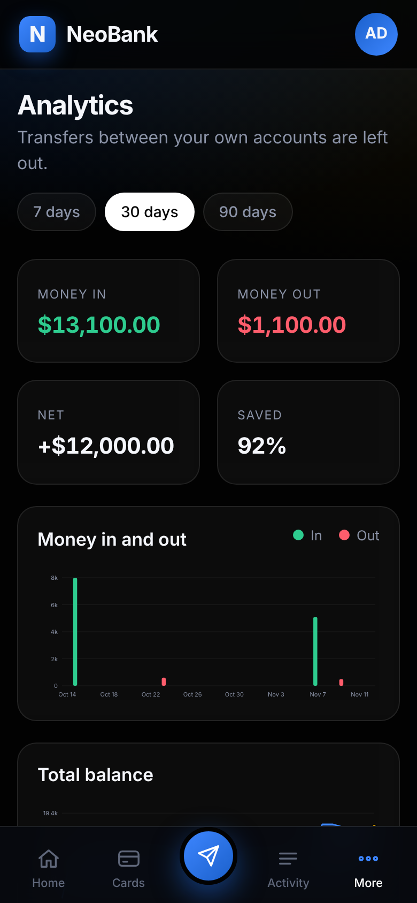
  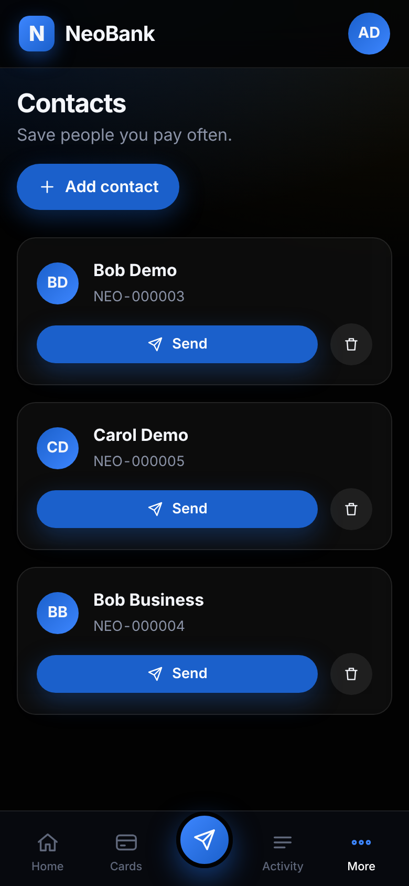
  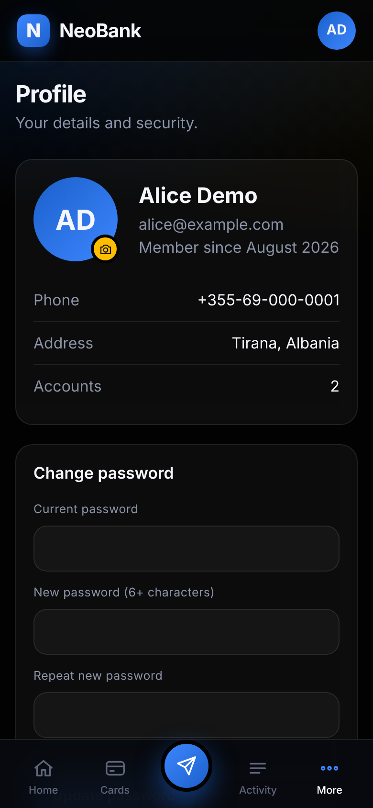

## Retaking them from the running app

1. Run `mvn spring-boot:run` and log in as `alice@example.com` / `alice123`.
2. Use a 1440 px wide window for desktop and the browser device toolbar at 390 px for phone, and save each screen as a PNG with the same file name.
3. Delete the grey note at the top of this file.
