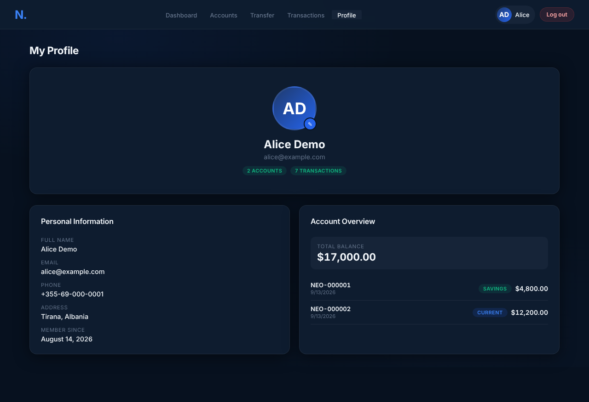

# Screenshots

The dashboard with the demo data (user **Alice Demo**), at 1280 px wide.

> These were captured from `index.html` with a stand-in API that returns the same demo data as a fresh install. To replace them with captures of the running app, follow the steps at the end.

| File | Screen |
|---|---|
| `login.png` | Login |
| `dashboard.png` | Dashboard with balance, stats, cards and recent transactions |
| `accounts.png` | Accounts |
| `transfer.png` | A completed transfer |
| `transactions.png` | Transaction history |
| `profile.png` | Profile |

## Login

## Dashboard

## Accounts

## Transfer

## Transactions

## Profile

## Retaking them from the running app

1. Run `mvn spring-boot:run` and log in as `alice@example.com` / `alice123`.
2. Use a window about 1280 px wide and save each screen as a PNG with the same file name.
3. Delete the grey note at the top of this file.
