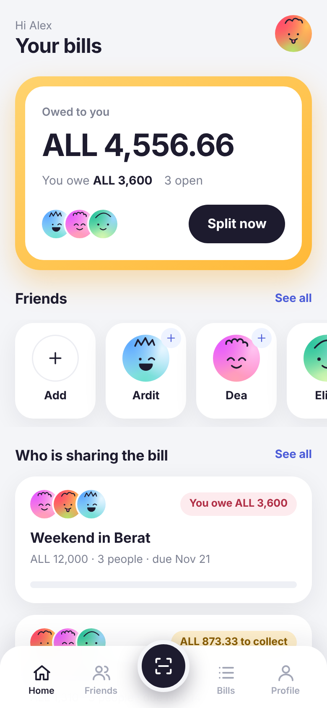
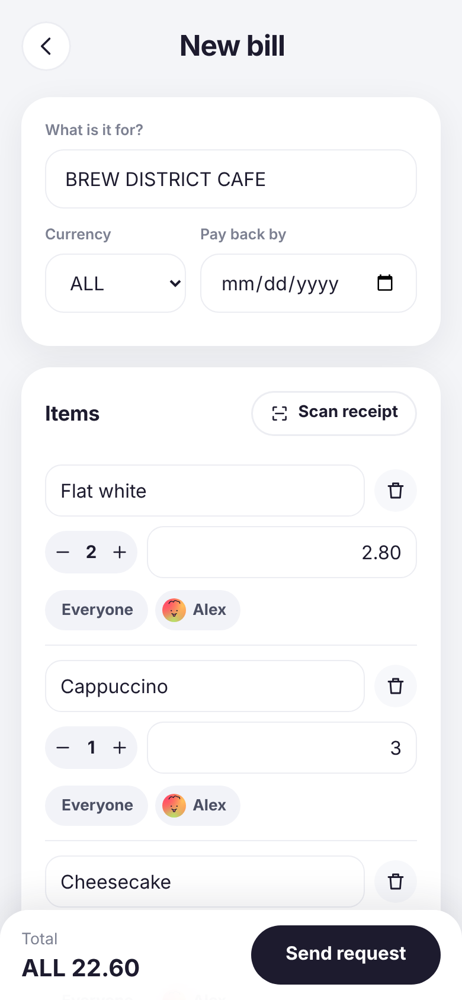
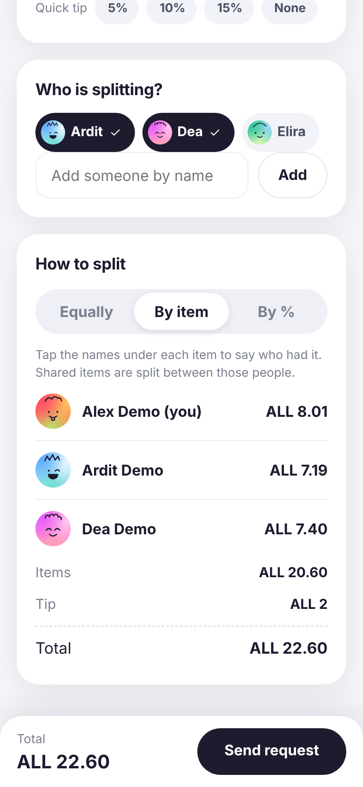
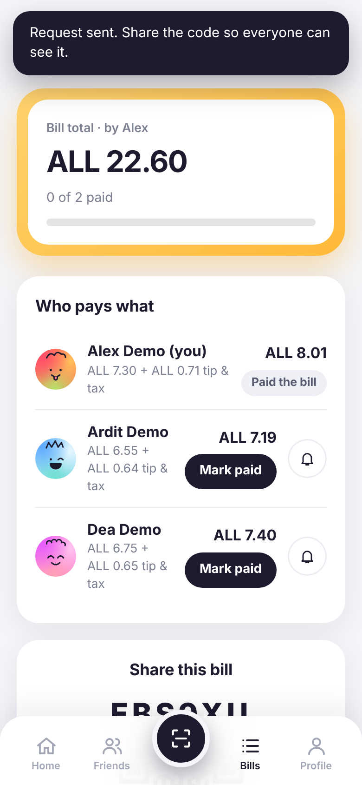
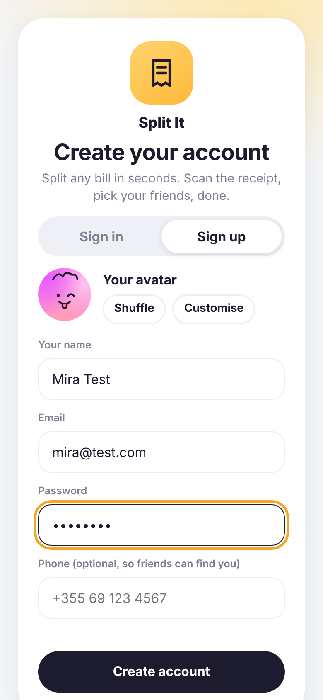
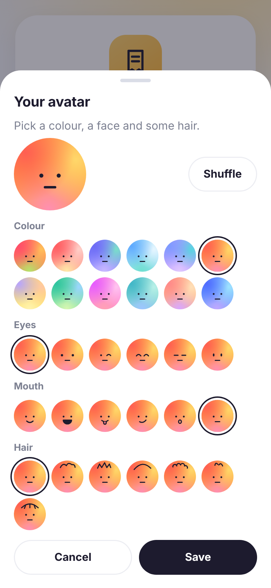
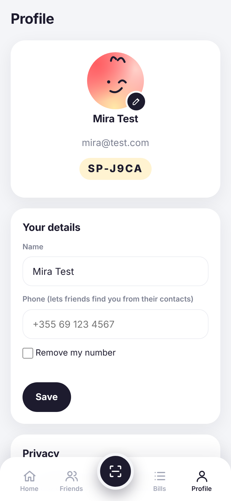
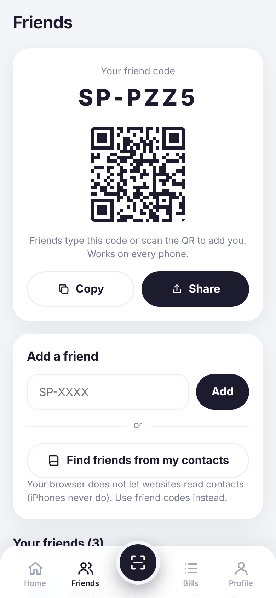
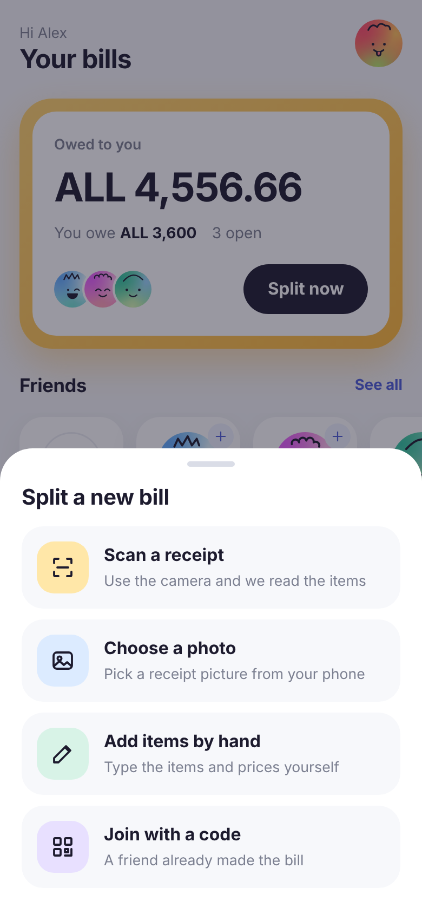
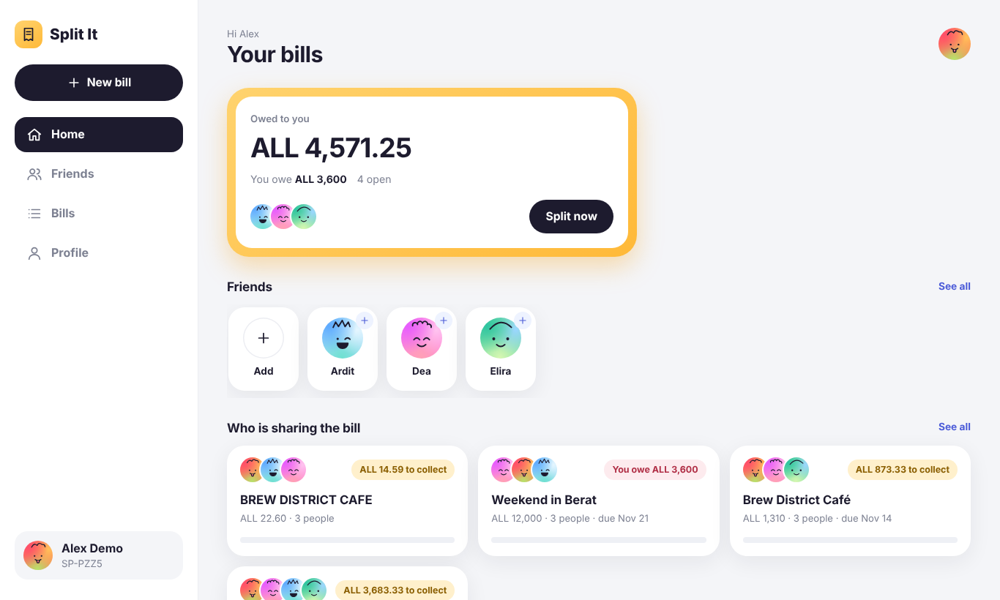

# Split It

Split a bill with friends. Scan the receipt with your phone, tick who had what, and everyone sees exactly what they owe. Built phone-first as a web app, and it also works on a desktop for bigger group bills.

| Home | Scan a receipt | Split by item | Who pays what |
|---|---|---|---|
|  |  |  |  |

| Sign up with an avatar | Build your avatar | Profile | Friends and share code |
|---|---|---|---|
|  |  |  |  |

| Start a bill | Desktop |
|---|---|
|  |  |

## What it does

- **Custom avatars.** Everyone builds their own: a gradient colour (12), eyes (6), mouth (6) and a hair doodle (7), 3,024 combinations. Pick it at sign-up or change it on the Profile screen, and friends see it everywhere. Avatars are drawn with CSS and a tiny inline SVG, so there are no image files. Guests added by name get their initials.
- **Reads receipts.** Take a photo or pick one from the gallery. The text is read in the browser (Tesseract OCR, bundled, nothing is uploaded) and turned into items, quantities, tip and tax. You always get an edit screen to fix mistakes.
- **Optional AI scan.** Set `ANTHROPIC_API_KEY` and the server reads the receipt with a vision model first. The browser OCR is the fallback.
- **Three ways to split.** Equally, by item (tap the names under each item) or by percentage. Tip and tax are shared in proportion. Totals are whole cents, so shares always add up to the bill exactly.
- **Finds friends.** Share a friend code (`SP-XXXX`), a QR code or a link. On Android Chrome you can also pick contacts and match them by phone number.
- **Joins a bill by code.** Every bill has a 6-character code and a QR. A friend who types or scans it sees their share.
- **Tracks payments.** Everyone can mark their own share as paid, the owner can mark anyone. The bill settles when all shares are paid.

## Run it

Needs Node 20 or newer.

```bash
npm install
npm test        # 28 tests: split maths, receipt parser, avatars, API
npm start       # http://localhost:3000
```

The first start creates `data/splitit.db` with demo data. Log in with `alex@example.com` / `alex123` (others: `dea@example.com` / `dea123`, and so on, see `src/seed.js`). Set `SPLITIT_SEED=0` to start empty.

### Settings (environment variables)

| Variable | Default | Purpose |
|---|---|---|
| `PORT` | `3000` | HTTP port |
| `SPLITIT_DB` | `./data/splitit.db` | SQLite file |
| `SPLITIT_JWT_SECRET` | random on every start | Signs login tokens. **Set a 32+ character value** or everyone is logged out on restart |
| `SPLITIT_PEPPER` | built-in dev value | Secret used to hash phone numbers. **Change it** in real use |
| `SPLITIT_DEFAULT_CC` | `355` | Country code assumed for numbers without one |
| `ANTHROPIC_API_KEY` | not set | Turns on the AI receipt scan |
| `SPLITIT_SEED` | on | `0` disables the demo data |

### Trying it on a real phone

The live camera and the contact picker only work on **https**. Plain `http://192.168.x.x:3000` still works for everything else, and the "Scan" button falls back to the phone's camera app. To get https, put a tunnel in front of the server, for example `cloudflared tunnel --url http://localhost:3000` or `ngrok http 3000`, and open the https address it prints.

Honest limits of the browser:

- **Contact picker:** Android Chrome only, https only. iPhones never allow websites to read contacts, so the friend code, QR and link are the main way to connect.
- **"Nearby" friends:** websites cannot scan for people around you. Joining the same bill by code or QR is the replacement.
- **OCR quality:** works best with a flat, well-lit photo. Crumpled thermal paper may need corrections on the edit screen.

## How it is built

```
src/
  server.js    start-up, env vars
  app.js       Express app: auth, friends, bills, receipt AI, static files
  bills.js     bill validation and service (create, edit, join, pay)
  split.js     money maths, shared with the browser (UMD)
  avatar.js    avatar codes and drawing, shared with the browser (UMD)
  db.js        SQLite schema (better-sqlite3)
  seed.js      demo data
  util.js      codes, errors, phone normalising
public/        vanilla JS single-page app (hash routing, no build step)
  receipt.js   receipt text parser (also unit tested)
  scan.js      camera, preprocessing, OCR, AI scan
  editor.js    bill editor and bill detail
  picker.js    avatar picker sheet
test/          node:test, real server on an ephemeral port
```

Decisions worth knowing:

- **Money is integer cents** everywhere. `distribute()` uses the largest-remainder method, so 10.00 split three ways is 3.34 / 3.33 / 3.33, never 9.99.
- **One split file for both sides.** `src/split.js` is loaded by the server and the browser, so the live total on screen always equals what the server saves.
- **Avatars are a code, not a picture.** `av:3.1.2.4` means palette 3, eyes 1, mouth 2, hair 4. The server accepts only valid codes, so there is nothing to upload or sanitise. The code lives in the `users.color` column, and rows that hold a plain colour (older data) simply show initials.
- **Phone numbers are never stored.** The server normalises a number and keeps only an HMAC-SHA256 with a secret pepper. Matching returns only name, friend code and colour, and only for people who registered a phone.
- **Security basics:** bcrypt passwords, 7-day JWT, rate-limited login, parameterised SQL, escaped output, strict CSP and security headers, owner-only edits.

### API

All routes are under `/api` and need `Authorization: Bearer <token>` except register and login.

| Method and path | Purpose |
|---|---|
| `POST /auth/register`, `POST /auth/login` | Create account, log in |
| `GET /me`, `PATCH /me` | Profile: name, phone, avatar (`av:P.E.M.H` code, validated) |
| `GET /friends`, `POST /friends/add`, `DELETE /friends/:id` | Friend list, add by code |
| `POST /friends/match` | Match phone numbers to registered users |
| `GET /summary` | Totals for the home screen |
| `GET /bills`, `POST /bills`, `GET/PUT/DELETE /bills/:id` | Bills |
| `POST /bills/join` | Join a bill by code |
| `POST /bills/:id/members/:mid/paid` | Mark a share paid or unpaid |
| `POST /receipt/ai` | AI receipt reading (501 without a key) |
| `GET /config` | Feature flags for the front end |

## Limits of this demo

Split It records who owes what. It does not move money. There is no email verification or password reset, and the rate limiter lives in memory, so it suits one server process only.
