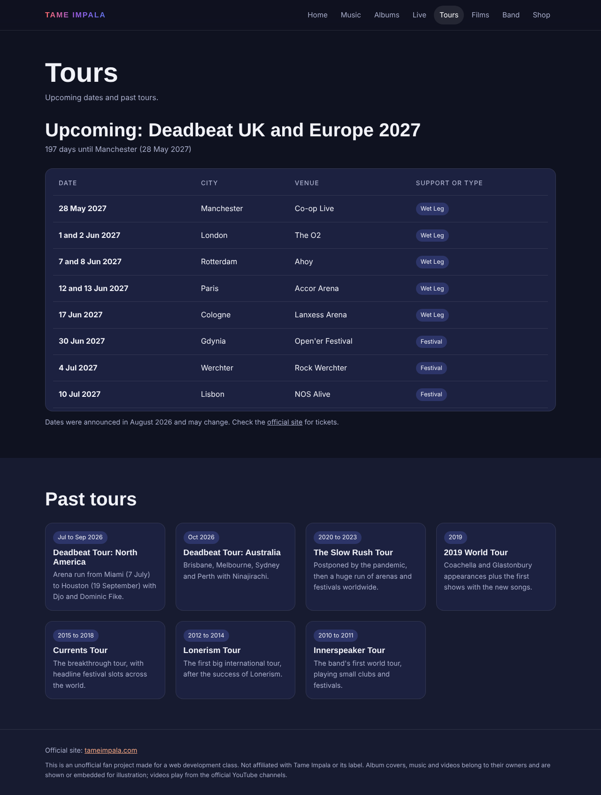
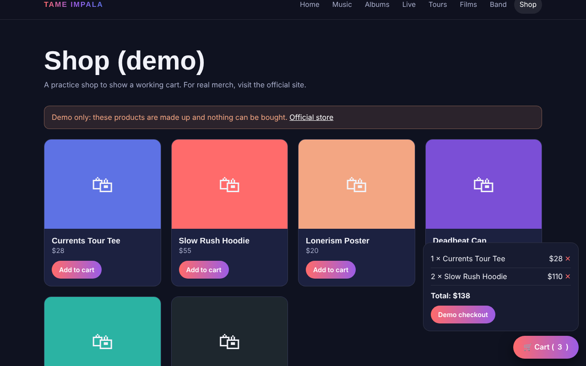
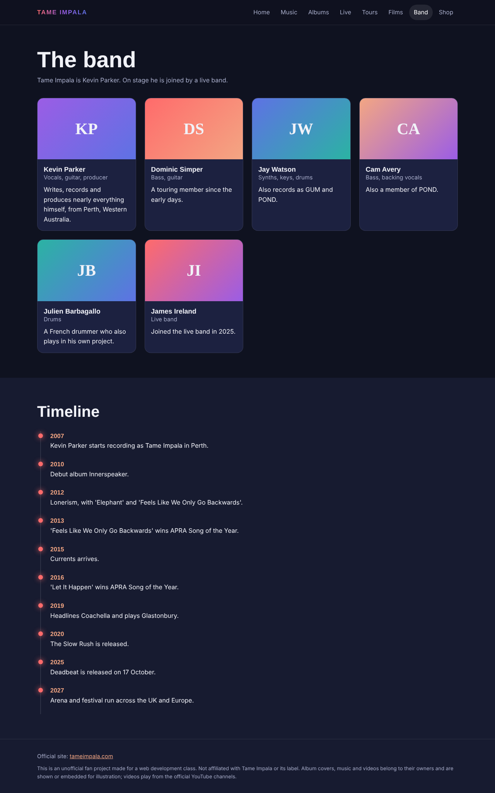
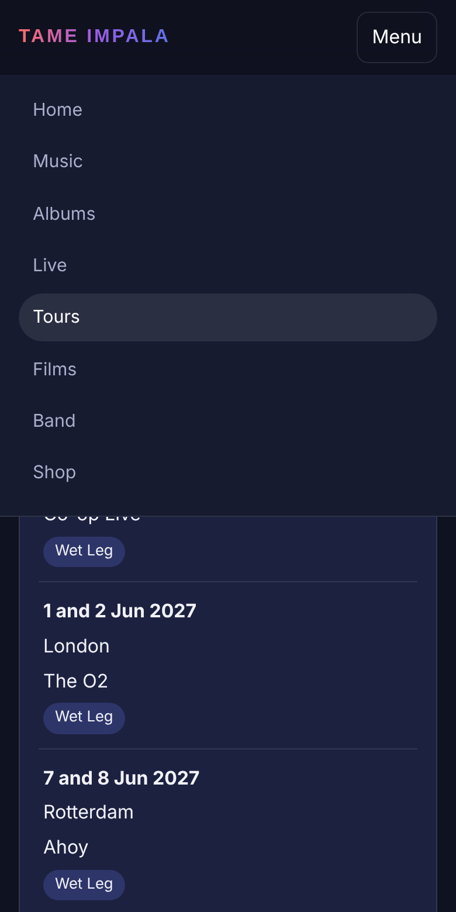

<h1 align="center">Tame Impala fan site</h1>

<p align="center">
  An unofficial, multi-page fan site with a music player, live videos, tours and albums, built with plain HTML, CSS and JavaScript.
</p>

---

## Overview

This site started as a web development class project and was rebuilt with real data: real albums and covers, official videos that play right on the page, real past tours and the announced 2027 dates. There is no build step and there are no frameworks. All the content lives in one file, [`js/data.js`](js/README.md), and the pages are drawn from it.

> **A fan project.** It is not affiliated with Tame Impala or its label. Covers, music and videos belong to their owners. Videos play from the official channels through YouTube's own player, and the shop is a demo where nothing can be bought.

## Pages

| Page | What it does |
|---|---|
| `index.html` | Home, with a 3D cover that tilts as you move the mouse, the five albums and the next shows |
| `music.html` | Custom player with a playlist, previous, next, a seek bar and repeat. It plays 14 official videos on the page |
| `albums.html` | The five studio albums with covers and tracklists. Pink tracks open in the player |
| `live.html` | Live clips: Coachella 2019, Glastonbury 2019, SNL, late-night TV and a Tiny Desk concert |
| `tours.html` | Upcoming 2027 UK and Europe dates with a countdown, plus every past tour |
| `films.html` | Five short films and behind-the-scenes videos (54 seconds to 1 hour) |
| `band.html` | The members and a timeline of the project |
| `shop.html` | A demo shop with a cart saved in the browser |

## Screenshots

<table>
  <tr>
    <td width="50%"><br><sub>Tours: 2027 dates and past tours</sub></td>
    <td width="50%"><br><sub>Demo shop with the cart open</sub></td>
  </tr>
  <tr>
    <td width="50%"><br><sub>Band members and timeline</sub></td>
    <td width="50%" align="center"><br><sub>Phone layout with the menu open</sub></td>
  </tr>
</table>

The pages that show album covers and videos (home, music, albums, live, films) are listed in the [screenshot guide](docs/screenshots/README.md).

## Features

| Area | What it does |
|---|---|
| **Player** | YouTube IFrame API with custom controls, a playlist, auto-play of the next song and a message with a search link if a video cannot be embedded |
| **Data-driven pages** | One data file feeds every page, so changing a song or a date takes one edit |
| **Interactive hero** | The cover tilts in 3D and follows the mouse or finger. It is switched off for people who prefer reduced motion |
| **Lazy video** | Live and film pages show a thumbnail and load the video only after a click, so pages stay fast |
| **Countdown** | Counts the days to the first 2027 show |
| **Demo cart** | Add and remove items, with the cart saved in `localStorage` |
| **Responsive and accessible** | Mobile menu, skip link, labelled buttons, keyboard focus styles and no horizontal scrolling on phones |

## Tech stack

| Layer | Technology |
|---|---|
| Markup | HTML5, one file per page |
| Styling | Plain CSS with variables, grid and flexbox |
| Logic | Plain JavaScript, no libraries |
| Video | YouTube IFrame API through `youtube-nocookie.com` |
| Fonts | Montserrat and Space Grotesk from Google Fonts |

## Quick start

```bash
git clone https://github.com/Garuli/projects.git
cd projects/Tame-Impala
python3 -m http.server 8000
```

Open http://localhost:8000. You can also open the folder in VS Code and start **Live Server**. The site needs an internet connection for the videos, covers and fonts.

## Project layout

```
Tame-Impala/
├── README.md          ← you are here
├── index.html         ← home
├── music.html         ← player
├── albums.html
├── live.html
├── tours.html
├── films.html
├── band.html
├── shop.html
├── css/               ← style.css, all styling
├── js/                ← data.js (content) and app.js (behaviour)
└── docs/              ← architecture, data guide, screenshots
```

Each folder has its own README. For how it all fits together, read [docs/ARCHITECTURE.md](docs/ARCHITECTURE.md). To change the content, read [docs/DATA.md](docs/DATA.md).

## Facts and sources

| Item | Note |
|---|---|
| YouTube videos | Every ID was checked with YouTube's embed check on 12 November 2026. Videos can be removed later, so test a song if it stops playing |
| Covers | Loaded from Wikimedia, with a gradient fallback |
| 2027 dates | Announced in August 2026. They can change, so check the [official site](https://www.tameimpala.com) |
| Awards in the timeline | APRA Song of the Year: 2013 ("Feels Like We Only Go Backwards") and 2016 ("Let It Happen") |

## What I changed from the class version

| Before | Now |
|---|---|
| One page | Eight pages with shared navigation |
| Placeholder images and made-up tour dates | Real covers and real tours |
| Links and `alert()` pop-ups | A working in-page player and a real cart |
| Four albums, a wrong award claim | Five albums including Deadbeat, with the award corrected |
| Tracklists only visible on hover | Tracklists always visible, so they work on phones |
