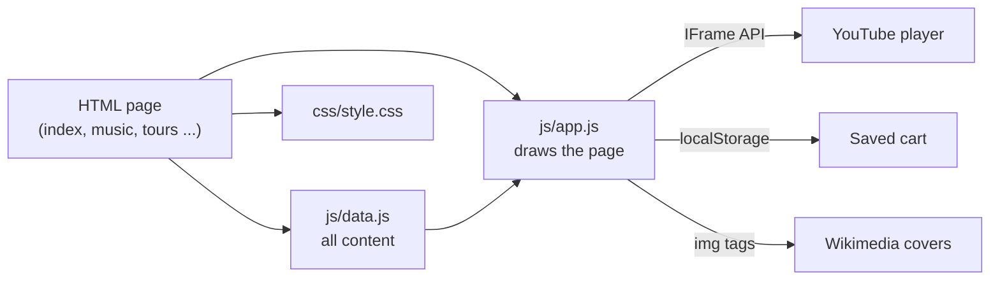
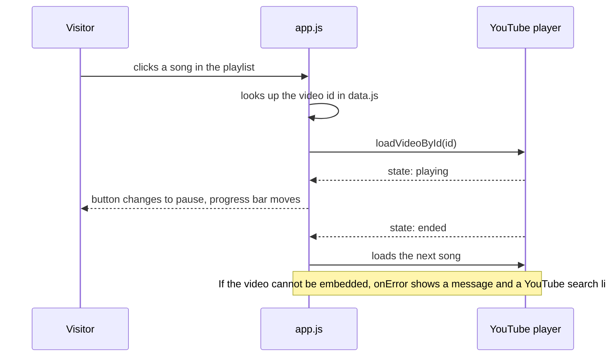

# Architecture

The site is static: there is no server code and no database. The browser loads an HTML page, and JavaScript fills it in from one data file.

## Layers

| Layer | File | Responsibility |
|---|---|---|
| Structure | `*.html` | Each page is a small shell with empty containers such as `
` |
| Content | `js/data.js` | The only place where songs, dates and names are written |
| Behaviour | `js/app.js` | Fills the containers, shares the header and footer, runs the player and cart |
| Looks | `css/style.css` | All colours, layout and responsive rules |

## Example: playing a song

## Design choices

| Choice | Why |
|---|---|
| Plain HTML, CSS and JavaScript | No tools to install. Edit a file and refresh |
| One data file | Changing a date or adding a song is one edit, and every page updates |
| YouTube embeds, not self-hosted audio | The music belongs to the artist. Playing it through the official channel is legal and free |
| `youtube-nocookie.com` | Fewer tracking cookies before the visitor presses play |
| Thumbnails first on Live and Films | The page does not load a dozen players until someone wants one |
| Gradient fallback for covers | If an image cannot load, the card still looks right |
| Header and footer written by JavaScript | The menu is defined once, not copied into eight files |

## Known limits

| Limit | Effect | Possible improvement |
|---|---|---|
| Needs the internet for videos, covers and fonts | Does not work offline | Save the covers into the repository |
| Videos can be removed or blocked by their owners | A song may show an error message | Re-check the ids from time to time |
| Menu and content need JavaScript | Without it the pages are mostly empty | Generate the pages with a small build script |
| Demo shop only | No real products or payments | Link to the official store |
