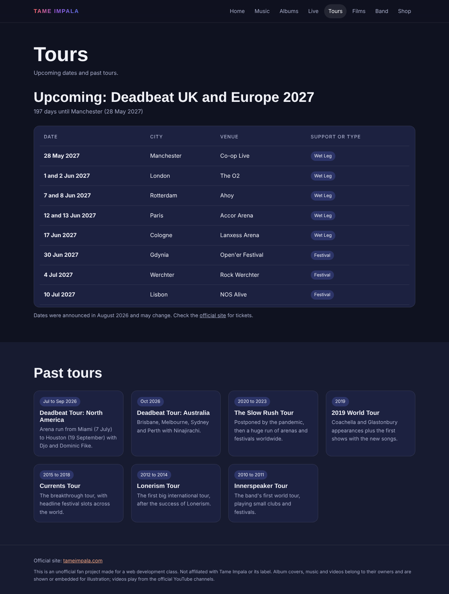
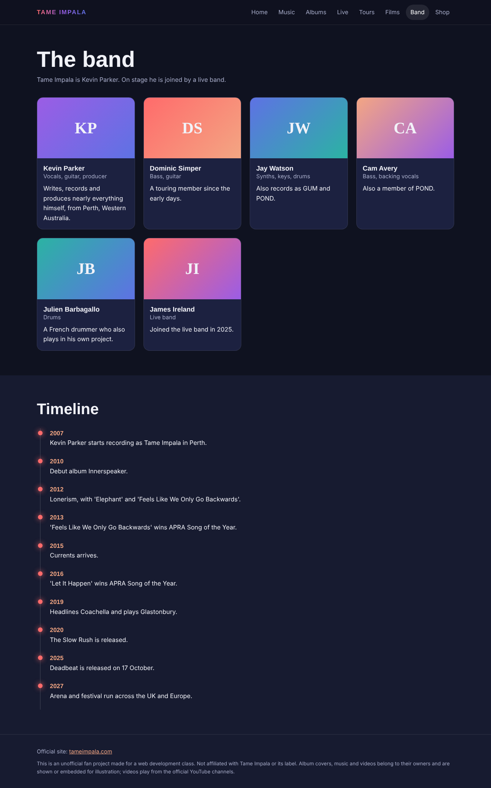
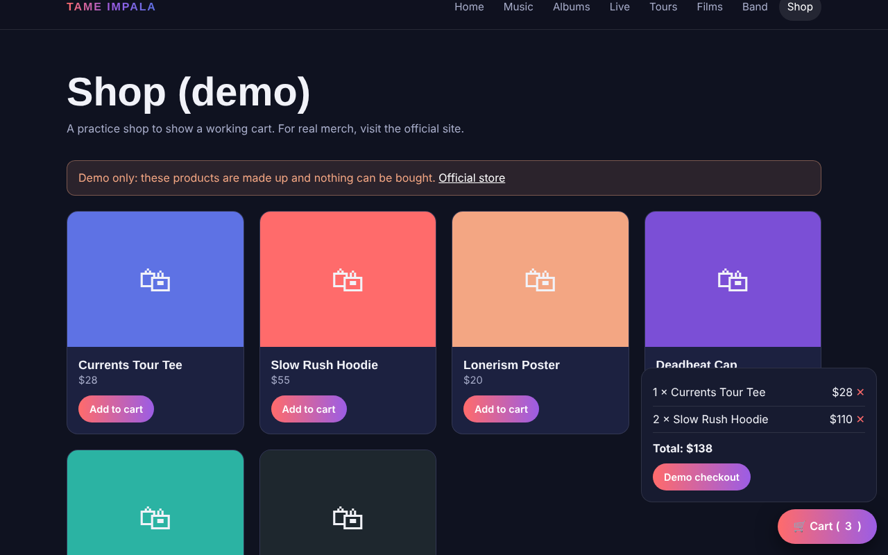
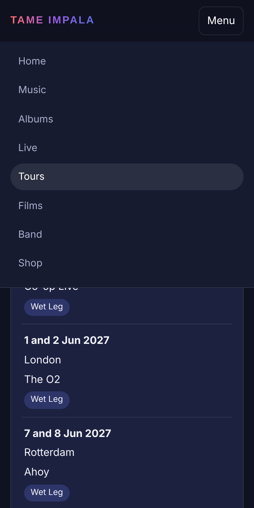

# Screenshots

Screenshots of the site, taken from a local copy at 1280 px wide (the phone one at 390 px).

| File | Screen |
|---|---|
| `tours.png` | Tours page with the 2027 dates and past tours |
| `band.png` | Band members and timeline |
| `shop-cart.png` | Demo shop with the cart open |
| `mobile-menu.png` | Phone layout with the menu open |

## Tours

## Band

## Demo shop

## Phone layout

## Still to add

The pages with covers and videos need a real internet connection to look right, so they were not captured here. To add them, run the site (`python3 -m http.server 8000`), open each page, wait for the covers to load, and save a screenshot with these names:

| File | Page |
|---|---|
| `home.png` | Home with the tilting cover |
| `music.png` | Music with a song playing |
| `albums.png` | Albums |
| `live.png` | Live |

Then add them to this README with `` and to the table in the main README.
